# nxnative Easy

[English](README.md) · **Español**

**Tus juegos de Switch. En tu Mac, iPhone y iPad.**

Una biblioteca que te lleva de tus propios archivos a una app lista para jugar, con preparación guiada, progreso de compilación en vivo, soporte para controles y botones táctiles a tu gusto.

### [↓ Descargar nxnative Easy para Mac](https://github.com/nalancer08/nxnative-easy/releases/latest/download/nxnative-Easy-macOS-arm64.zip)

Descomprime → arrastra **nxnative Easy.app** a **Aplicaciones** → ábrela. **Sin Terminal ni compilar la interfaz.** La app incluye sus herramientas.

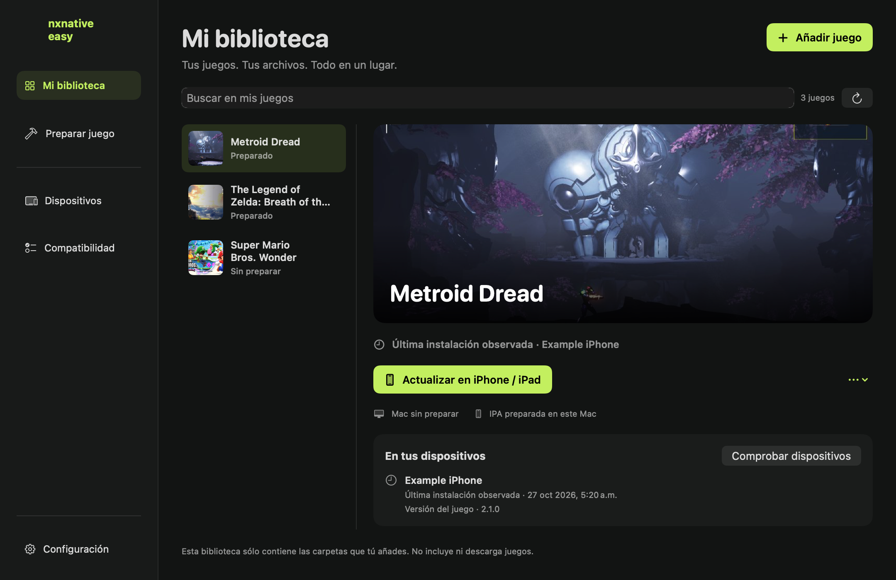

## Antes de empezar

- **Una Mac con Apple silicon** (M1 o posterior), **macOS 26.6+** y **Xcode 27.1** instalado y abierto al menos una vez. Xcode compila tus juegos; tú no necesitas compilar nxnative Easy.
- **Tus propios archivos del juego y `prod.keys`.** No se incluyen ni descargan juegos o llaves.
- Para iPhone/iPad: **iOS/iPadOS 26+**, un **iPhone con A17 Pro o posterior**, o un **iPad con M1 o posterior**. Usas tu propia cuenta Apple para firmar e instalar.

Si macOS bloquea la primera apertura, entra a **Configuración del Sistema → Privacidad y seguridad → Abrir de todos modos** para esta descarga. La app lleva firma ad hoc; no está notarizada con un Developer ID de pago.

## Añade tu juego. Sigue los pasos. Juega.

1. Abre **Mi biblioteca → Añadir juego** y elige **Mac** o **iPhone / iPad**.
2. Elige la carpeta de tu juego o arrastra sus archivos. Selecciona tu **archivo `prod.keys`**. La app identifica el juego, su versión y los updates disponibles **antes de compilar**.
3. Revisa y pulsa **Preparar juego**. Durante el proceso verás etapas, contadores y el registro en vivo.
4. **Mac:** pulsa **Jugar en Mac**. **iPhone / iPad:** continúa con **dispositivo → cuenta Apple → revisar → instalar**. La app te guía con la firma, instalación y transferencia de los datos del juego.

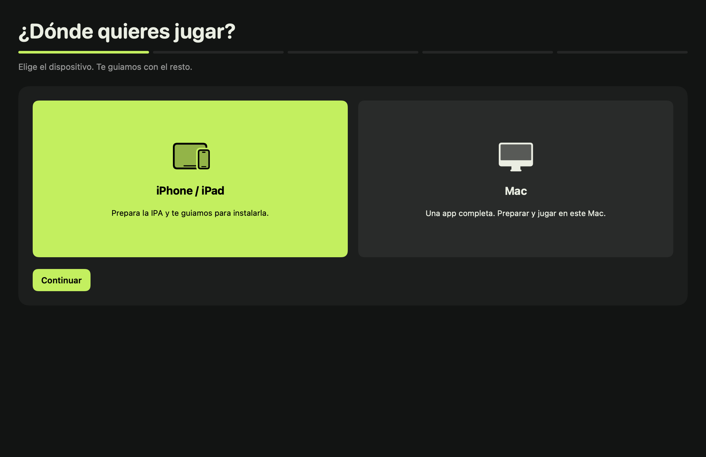 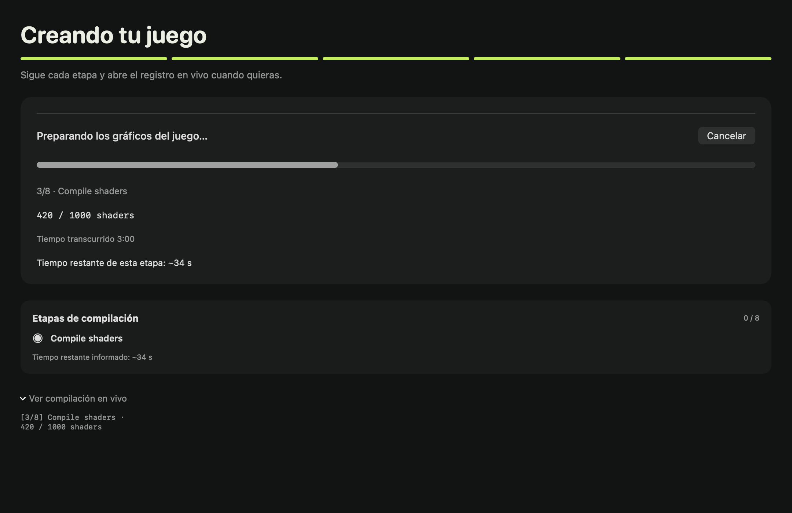

| Juega en… | Qué obtienes |
|---|---|
| **Mac** | Una `.app` completa con los datos del juego incluidos. Ábrela desde tu biblioteca. |
| **iPhone / iPad** | Una IPA para instalar en tu dispositivo. Elige una versión ligera con los datos por separado o inclúyelos dentro de la IPA. También puedes usar Sideloadly como alternativa. |

**¿Ya lo tienes instalado?** Usa **Preparar o actualizar** para recompilar con un update del juego o un motor nuevo. En iOS, instala encima de la app existente con la misma cuenta/equipo Apple e identidad de la app para conservar sus datos. No desinstales primero el juego. [Detalles de actualización e instalación](docs/personal-ios.md).

## Todo en un lugar

- **Tu biblioteca:** imágenes, buscador, versiones preparadas e instalaciones verificadas en tus dispositivos conectados.
- **Tus controles:** Xbox, PS5 y PS4, con una prueba de botones y sticks en **Configuración**. En iPhone/iPad puedes mover y cambiar el tamaño de los botones táctiles y guardar **cuatro perfiles con nombre** por juego.
- **Tus ajustes:** opciones de inicio por juego en Mac y limpieza de cachés con una vista previa de lo que se borrará.
- **Tus partidas:** se quedan en tu dispositivo y puedes exportarlas para compartirlas a mano o respaldarlas. Exportar partidas y copiar datos del juego **no** requieren iniciar sesión con Apple. [Guía de partidas](docs/saves-es.md).
- **Tu cuenta Apple:** una para toda la app, con sesión recordada en el Llavero, revisión de dispositivos y renovación opcional de firmas en segundo plano. [Requisitos de renovación](docs/background-renewal.md).
- **Actualizaciones de la app:** pulsa **Actualizar ahora** cuando aparezca una versión. La app descarga y verifica el paquete, conserva la app anterior como respaldo y mantiene tus juegos y partidas. Para aplicar un motor nuevo a un juego existente, vuelve a prepararlo.

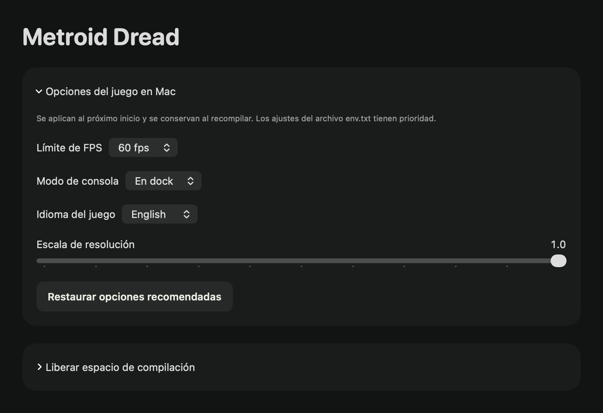 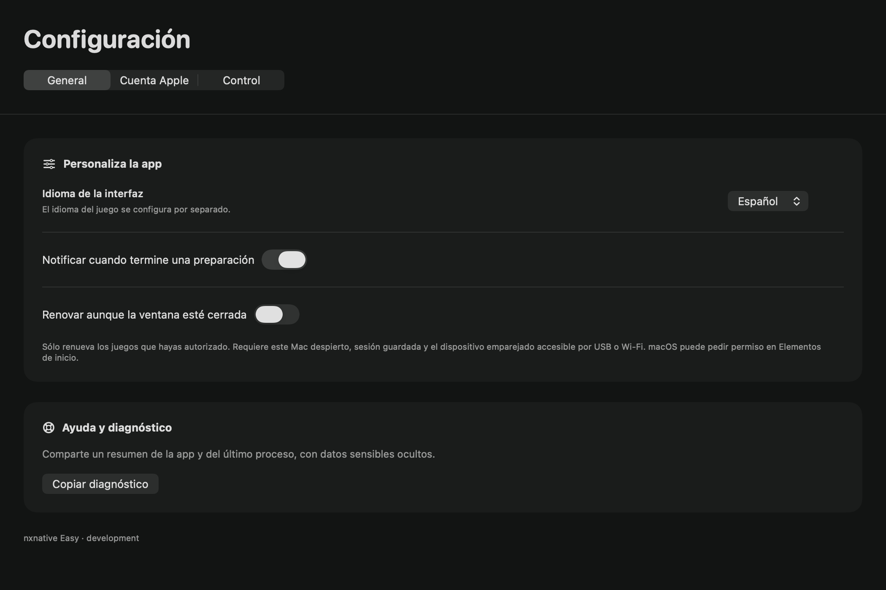

La interfaz empieza en **inglés**; cámbiala a **Español** en **Settings → General**.

## Encuentra tu juego

Consulta **Compatibilidad** en la app o abre una ficha de abajo para ver versiones compatibles, dispositivos probados y notas específicas. El soporte depende del juego, versión y dispositivo. El motor actual permite jugar sin conexión; los servicios en línea de Nintendo y LAN/netplay no están disponibles.

Las imágenes de abajo muestran perfiles de juegos con soporte. **Tú debes aportar los archivos del juego.**

<!-- BEGIN GENERATED GAME GALLERY -->
98 perfiles. Consulta la ficha de cada juego para ver versiones y dispositivos probados.

<table>
<tr>
<td align="center" valign="top" width="33%" data-title-id="01003FC01670C000"><a href="dm/games/01003FC01670C000/README.md"></a><br><a href="dm/games/01003FC01670C000/README.md">13 Sentinels: Aegis Rim</a><br><sub>~5 GB</sub></td>
<td align="center" valign="top" width="33%" data-title-id="01008D7016438000"><a href="dm/games/01008D7016438000/README.md"></a><br><a href="dm/games/01008D7016438000/README.md">13 Sentinels: Aegis Rim (Asia)</a><br><sub>~5 GB</sub></td>
<td align="center" valign="top" width="33%" data-title-id="010045C014650000"><a href="dm/games/010045C014650000/README.md"></a><br><a href="dm/games/010045C014650000/README.md">13 Sentinels: Aegis Rim (Japan)</a><br><sub>13 Sentinels: Aegis Rim~5 GB</sub></td>
</tr>
<tr>
<td align="center" valign="top" width="33%" data-title-id="0100A83022A22000"><a href="dm/games/0100A83022A22000/README.md"></a><br><a href="dm/games/0100A83022A22000/README.md">Absolum</a><br><sub>~2 GB</sub></td>
<td align="center" valign="top" width="33%" data-title-id="010005501E68C000"><a href="dm/games/010005501E68C000/README.md"></a><br><a href="dm/games/010005501E68C000/README.md">Ace Attorney Investigations Collection</a><br><sub>~7 GB</sub></td>
<td align="center" valign="top" width="33%" data-title-id="0100300012F2A000"><a href="dm/games/0100300012F2A000/README.md"></a><br><a href="dm/games/0100300012F2A000/README.md">Advance Wars 1+2: Re-Boot Camp</a><br><sub>~7.1 GB</sub></td>
</tr>
<tr>
<td align="center" valign="top" width="33%" data-title-id="010089B00D09C000"><a href="dm/games/010089B00D09C000/README.md"></a><br><a href="dm/games/010089B00D09C000/README.md">AI: THE SOMNIUM FILES</a><br><sub>~8.3 GB</sub></td>
<td align="center" valign="top" width="33%" data-title-id="0100713016CCC000"><a href="dm/games/0100713016CCC000/README.md"></a><br><a href="dm/games/0100713016CCC000/README.md">AI: THE SOMNIUM FILES - nirvanA Initiative</a><br><sub>~11.6 GB</sub></td>
<td align="center" valign="top" width="33%" data-title-id="01006F8002326000"><a href="dm/games/01006F8002326000/README.md"></a><br><a href="dm/games/01006F8002326000/README.md">Animal Crossing: New Horizons</a><br><sub>~10.5 GB</sub></td>
</tr>
<tr>
<td align="center" valign="top" width="33%" data-title-id="010020D01AD24000"><a href="dm/games/010020D01AD24000/README.md"></a><br><a href="dm/games/010020D01AD24000/README.md">ANIMAL WELL</a><br><sub>~54 MB</sub></td>
<td align="center" valign="top" width="33%" data-title-id="01007300020FA000"><a href="dm/games/01007300020FA000/README.md"></a><br><a href="dm/games/01007300020FA000/README.md">ASTRAL CHAIN</a><br><sub>~9.7 GB · 60 fps target with 1.0.1</sub></td>
<td align="center" valign="top" width="33%" data-title-id="0100CD801CE5E000"><a href="dm/games/0100CD801CE5E000/README.md"></a><br><a href="dm/games/0100CD801CE5E000/README.md">Balatro</a><br><sub>~82 MB · played by touch</sub></td>
</tr>
<tr>
<td align="center" valign="top" width="33%" data-title-id="010086A022444000"><a href="dm/games/010086A022444000/README.md"></a><br><a href="dm/games/010086A022444000/README.md">BALL x PIT</a><br><sub>~1.1 GB</sub></td>
<td align="center" valign="top" width="33%" data-title-id="010076F0049A2000"><a href="dm/games/010076F0049A2000/README.md"></a><br><a href="dm/games/010076F0049A2000/README.md">Bayonetta</a><br><sub>~8.8 GB</sub></td>
<td align="center" valign="top" width="33%" data-title-id="01007960049A0000"><a href="dm/games/01007960049A0000/README.md"></a><br><a href="dm/games/01007960049A0000/README.md">Bayonetta 2</a><br><sub>~12.5 GB</sub></td>
</tr>
<tr>
<td align="center" valign="top" width="33%" data-title-id="01004A4010FEA000"><a href="dm/games/01004A4010FEA000/README.md"></a><br><a href="dm/games/01004A4010FEA000/README.md">Bayonetta 3</a><br><sub>~14.2 GB</sub></td>
<td align="center" valign="top" width="33%" data-title-id="0100620012D6E000"><a href="dm/games/0100620012D6E000/README.md"></a><br><a href="dm/games/0100620012D6E000/README.md">Big Brain Academy: Brain vs. Brain</a><br><sub>~0.8 GB</sub></td>
<td align="center" valign="top" width="33%" data-title-id="0100698009C6E000"><a href="dm/games/0100698009C6E000/README.md"></a><br><a href="dm/games/0100698009C6E000/README.md">Blasphemous</a><br><sub>~0.9 GB</sub></td>
</tr>
<tr>
<td align="center" valign="top" width="33%" data-title-id="010040801A4C8000"><a href="dm/games/010040801A4C8000/README.md"></a><br><a href="dm/games/010040801A4C8000/README.md">Blasphemous 2</a><br><sub>~1.5 GB</sub></td>
<td align="center" valign="top" width="33%" data-title-id="0100F5D01DA3A000"><a href="dm/games/0100F5D01DA3A000/README.md"></a><br><a href="dm/games/0100F5D01DA3A000/README.md">Brain Memory Training Academy</a><br><sub>~0.1 GB</sub></td>
<td align="center" valign="top" width="33%" data-title-id="01009BF0072D4000"><a href="dm/games/01009BF0072D4000/README.md"></a><br><a href="dm/games/01009BF0072D4000/README.md">Captain Toad: Treasure Tracker</a><br><sub>~2 GB</sub></td>
</tr>
<tr>
<td align="center" valign="top" width="33%" data-title-id="0100BF00112C0000"><a href="dm/games/0100BF00112C0000/README.md"></a><br><a href="dm/games/0100BF00112C0000/README.md">Catherine: Full Body</a><br><sub>~14 GB</sub></td>
<td align="center" valign="top" width="33%" data-title-id="01002B30028F6000"><a href="dm/games/01002B30028F6000/README.md"></a><br><a href="dm/games/01002B30028F6000/README.md">Celeste</a><br><sub>~0.9 GB</sub></td>
<td align="center" valign="top" width="33%" data-title-id="01002E7016C46000"><a href="dm/games/01002E7016C46000/README.md">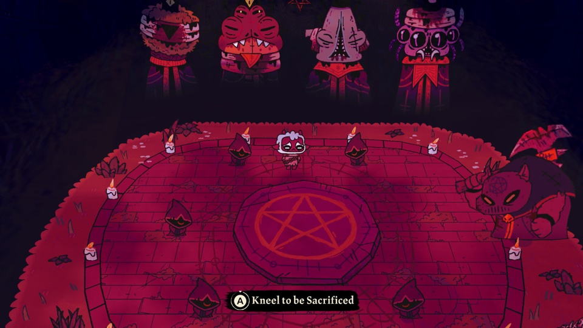</a><br><a href="dm/games/01002E7016C46000/README.md">Cult of the Lamb</a><br><sub>Ver ficha del juego</sub></td>
</tr>
<tr>
<td align="center" valign="top" width="33%" data-title-id="0100A5C00D162000"><a href="dm/games/0100A5C00D162000/README.md"></a><br><a href="dm/games/0100A5C00D162000/README.md">Cuphead</a><br><sub>~5 GB</sub></td>
<td align="center" valign="top" width="33%" data-title-id="01004AB00A260000"><a href="dm/games/01004AB00A260000/README.md"></a><br><a href="dm/games/01004AB00A260000/README.md">DARK SOULS: REMASTERED</a><br><sub>~4 GB · 60 fps with 1.0.3</sub></td>
<td align="center" valign="top" width="33%" data-title-id="010014E00DB56000"><a href="dm/games/010014E00DB56000/README.md"></a><br><a href="dm/games/010014E00DB56000/README.md">Digimon Story Cyber Sleuth: Complete Edition</a><br><sub>~5 GB</sub></td>
</tr>
<tr>
<td align="center" valign="top" width="33%" data-title-id="01009D901BC56000"><a href="dm/games/01009D901BC56000/README.md"></a><br><a href="dm/games/01009D901BC56000/README.md">Donkey Kong Country Returns HD</a><br><sub>~11.6 GB</sub></td>
<td align="center" valign="top" width="33%" data-title-id="0100C1F0051B6000"><a href="dm/games/0100C1F0051B6000/README.md"></a><br><a href="dm/games/0100C1F0051B6000/README.md">Donkey Kong Country: Tropical Freeze</a><br><sub>~7.3 GB</sub></td>
<td align="center" valign="top" width="33%" data-title-id="0100A9D01C446000"><a href="dm/games/0100A9D01C446000/README.md"></a><br><a href="dm/games/0100A9D01C446000/README.md">DRAGON QUEST VII Reimagined</a><br><sub>~5.9 GB</sub></td>
</tr>
<tr>
<td align="center" valign="top" width="33%" data-title-id="01006C300E9F0000"><a href="dm/games/01006C300E9F0000/README.md"></a><br><a href="dm/games/01006C300E9F0000/README.md">DRAGON QUEST XI S: Echoes of an Elusive Age – Definitive Edition</a><br><sub>~15 GB · 60 fps with 1.0.4</sub></td>
<td align="center" valign="top" width="33%" data-title-id="0100CE4010AAC000"><a href="dm/games/0100CE4010AAC000/README.md"></a><br><a href="dm/games/0100CE4010AAC000/README.md">FINAL FANTASY CRYSTAL CHRONICLES Remastered Edition</a><br><sub>Ver ficha del juego</sub></td>
<td align="center" valign="top" width="33%" data-title-id="0100606026F12000"><a href="dm/games/0100606026F12000/README.md"></a><br><a href="dm/games/0100606026F12000/README.md">FINAL FANTASY RESONANCE</a><br><sub>~10 GB · 60 fps with 1.0.1</sub></td>
</tr>
<tr>
<td align="center" valign="top" width="33%" data-title-id="0100B8A026F14000"><a href="dm/games/0100B8A026F14000/README.md"></a><br><a href="dm/games/0100B8A026F14000/README.md">FINAL FANTASY RESONANCE (Asian release)</a><br><sub>FINAL FANTASY RESONANCE~10 GB · 60 fps with 1.0.1</sub></td>
<td align="center" valign="top" width="33%" data-title-id="010038B015560000"><a href="dm/games/010038B015560000/README.md"></a><br><a href="dm/games/010038B015560000/README.md">FINAL FANTASY TACTICS - The Ivalice Chronicles</a><br><sub>~11 GB</sub></td>
<td align="center" valign="top" width="33%" data-title-id="0100BC300CB48000"><a href="dm/games/0100BC300CB48000/README.md"></a><br><a href="dm/games/0100BC300CB48000/README.md">FINAL FANTASY X/X-2 HD Remaster</a><br><sub>~26.5 GB</sub></td>
</tr>
<tr>
<td align="center" valign="top" width="33%" data-title-id="0100A6301214E000"><a href="dm/games/0100A6301214E000/README.md"></a><br><a href="dm/games/0100A6301214E000/README.md">Fire Emblem Engage</a><br><sub>~15 GB · 60 fps with 2.0.0</sub></td>
<td align="center" valign="top" width="33%" data-title-id="010055D009F78000"><a href="dm/games/010055D009F78000/README.md"></a><br><a href="dm/games/010055D009F78000/README.md">Fire Emblem: Three Houses</a><br><sub>~13 GB · 60 fps with 1.2.0</sub></td>
<td align="center" valign="top" width="33%" data-title-id="010029B018432000"><a href="dm/games/010029B018432000/README.md"></a><br><a href="dm/games/010029B018432000/README.md">Ghost Trick: Phantom Detective</a><br><sub>~3 GB</sub></td>
</tr>
<tr>
<td align="center" valign="top" width="33%" data-title-id="0100535012974000"><a href="dm/games/0100535012974000/README.md"></a><br><a href="dm/games/0100535012974000/README.md">Hades</a><br><sub>~4 GB</sub></td>
<td align="center" valign="top" width="33%" data-title-id="0100A00019DE0000"><a href="dm/games/0100A00019DE0000/README.md"></a><br><a href="dm/games/0100A00019DE0000/README.md">Hades II</a><br><sub>~4 GB</sub></td>
<td align="center" valign="top" width="33%" data-title-id="010013C00E930000"><a href="dm/games/010013C00E930000/README.md"></a><br><a href="dm/games/010013C00E930000/README.md">Hollow Knight: Silksong</a><br><sub>~6.4 GB</sub></td>
</tr>
<tr>
<td align="center" valign="top" width="33%" data-title-id="01002B00111A2000"><a href="dm/games/01002B00111A2000/README.md"></a><br><a href="dm/games/01002B00111A2000/README.md">Hyrule Warriors: Age of Calamity</a><br><sub>~15 GB · 60 fps with 1.3.0</sub></td>
<td align="center" valign="top" width="33%" data-title-id="01004D300C5AE000"><a href="dm/games/01004D300C5AE000/README.md"></a><br><a href="dm/games/01004D300C5AE000/README.md">Kirby and the Forgotten Land</a><br><sub>~6.4 GB</sub></td>
<td align="center" valign="top" width="33%" data-title-id="0100DCA0064A6000"><a href="dm/games/0100DCA0064A6000/README.md"></a><br><a href="dm/games/0100DCA0064A6000/README.md">Luigi&#x27;s Mansion 3</a><br><sub>~7.5 GB · 60 fps with 1.4.0</sub></td>
</tr>
<tr>
<td align="center" valign="top" width="33%" data-title-id="0100152000022000"><a href="dm/games/0100152000022000/README.md"></a><br><a href="dm/games/0100152000022000/README.md">Mario Kart 8 Deluxe</a><br><sub>~11.9 GB · no Mii heads</sub></td>
<td align="center" valign="top" width="33%" data-title-id="010067300059A000"><a href="dm/games/010067300059A000/README.md"></a><br><a href="dm/games/010067300059A000/README.md">Mario + Rabbids Kingdom Battle</a><br><sub>~5 GB</sub></td>
<td align="center" valign="top" width="33%" data-title-id="0100317013770000"><a href="dm/games/0100317013770000/README.md"></a><br><a href="dm/games/0100317013770000/README.md">Mario + Rabbids® Sparks of Hope</a><br><sub>~9.8 GB</sub></td>
</tr>
<tr>
<td align="center" valign="top" width="33%" data-title-id="0100B99019412000"><a href="dm/games/0100B99019412000/README.md"></a><br><a href="dm/games/0100B99019412000/README.md">Mario vs. Donkey Kong</a><br><sub>~1.6 GB</sub></td>
<td align="center" valign="top" width="33%" data-title-id="010093801237C000"><a href="dm/games/010093801237C000/README.md"></a><br><a href="dm/games/010093801237C000/README.md">Metroid Dread</a><br><sub>~5 GB</sub></td>
<td align="center" valign="top" width="33%" data-title-id="0100B04011742000"><a href="dm/games/0100B04011742000/README.md"></a><br><a href="dm/games/0100B04011742000/README.md">Monster Hunter Rise</a><br><sub>~22 GB · 60 fps with 16.0.2</sub></td>
</tr>
<tr>
<td align="center" valign="top" width="33%" data-title-id="010051701FB46000"><a href="dm/games/010051701FB46000/README.md"></a><br><a href="dm/games/010051701FB46000/README.md">Monster Train 2</a><br><sub>~1.6 GB · 60 fps with 1.1.1</sub></td>
<td align="center" valign="top" width="33%" data-title-id="010056B015FE8000"><a href="dm/games/010056B015FE8000/README.md"></a><br><a href="dm/games/010056B015FE8000/README.md">NieR:Automata The End of YoRHa Edition</a><br><sub>~10.9 GB · 60 fps with 1.0.3</sub></td>
<td align="center" valign="top" width="33%" data-title-id="0100B8E016F76000"><a href="dm/games/0100B8E016F76000/README.md"></a><br><a href="dm/games/0100B8E016F76000/README.md">NieR:Automata The End of YoRHa Edition</a><br><sub>~10.9 GB · 60 fps with 1.0.3</sub></td>
</tr>
<tr>
<td align="center" valign="top" width="33%" data-title-id="010057D006492000"><a href="dm/games/010057D006492000/README.md"></a><br><a href="dm/games/010057D006492000/README.md">OCTOPATH TRAVELER</a><br><sub>~3.6 GB</sub></td>
<td align="center" valign="top" width="33%" data-title-id="01005270232F2000"><a href="dm/games/01005270232F2000/README.md"></a><br><a href="dm/games/01005270232F2000/README.md">OCTOPATH TRAVELER 0</a><br><sub>~4 GB · 60 fps with 1.0.5</sub></td>
<td align="center" valign="top" width="33%" data-title-id="0100A3501946E000"><a href="dm/games/0100A3501946E000/README.md"></a><br><a href="dm/games/0100A3501946E000/README.md">OCTOPATH TRAVELER II</a><br><sub>~5.9 GB · 60 fps with 1.1.1</sub></td>
</tr>
<tr>
<td align="center" valign="top" width="33%" data-title-id="0100A3900C3E2000"><a href="dm/games/0100A3900C3E2000/README.md">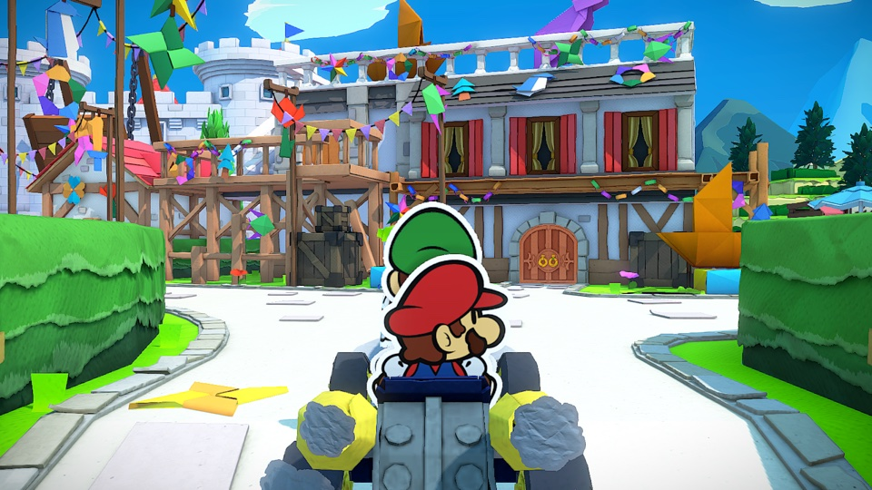</a><br><a href="dm/games/0100A3900C3E2000/README.md">Paper Mario: The Origami King</a><br><sub>Ver ficha del juego</sub></td>
<td align="center" valign="top" width="33%" data-title-id="0100ECD018EBE000"><a href="dm/games/0100ECD018EBE000/README.md"></a><br><a href="dm/games/0100ECD018EBE000/README.md">Paper Mario: The Thousand-Year Door</a><br><sub>~5 GB · 60 fps with 1.0.1</sub></td>
<td align="center" valign="top" width="33%" data-title-id="0100E44016C22000"><a href="dm/games/0100E44016C22000/README.md"></a><br><a href="dm/games/0100E44016C22000/README.md">Patrick&#x27;s Parabox</a><br><sub>~0.2 GB</sub></td>
</tr>
<tr>
<td align="center" valign="top" width="33%" data-title-id="010062B01525C000"><a href="dm/games/010062B01525C000/README.md">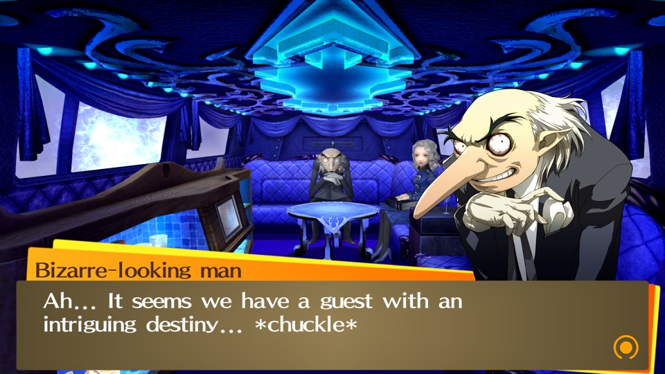</a><br><a href="dm/games/010062B01525C000/README.md">Persona 4 Golden</a><br><sub>Ver ficha del juego</sub></td>
<td align="center" valign="top" width="33%" data-title-id="01005CA01580E000"><a href="dm/games/01005CA01580E000/README.md"></a><br><a href="dm/games/01005CA01580E000/README.md">Persona 5 Royal</a><br><sub>~14.9 GB</sub></td>
<td align="center" valign="top" width="33%" data-title-id="0100B7C00933A000"><a href="dm/games/0100B7C00933A000/README.md"></a><br><a href="dm/games/0100B7C00933A000/README.md">Pikmin 4</a><br><sub>~10.8 GB</sub></td>
</tr>
<tr>
<td align="center" valign="top" width="33%" data-title-id="0100000011D90000"><a href="dm/games/0100000011D90000/README.md"></a><br><a href="dm/games/0100000011D90000/README.md">Pokémon Brilliant Diamond</a><br><sub>~4.6 GB · 60 fps with 1.3.0</sub></td>
<td align="center" valign="top" width="33%" data-title-id="01001F5010DFA000"><a href="dm/games/01001F5010DFA000/README.md">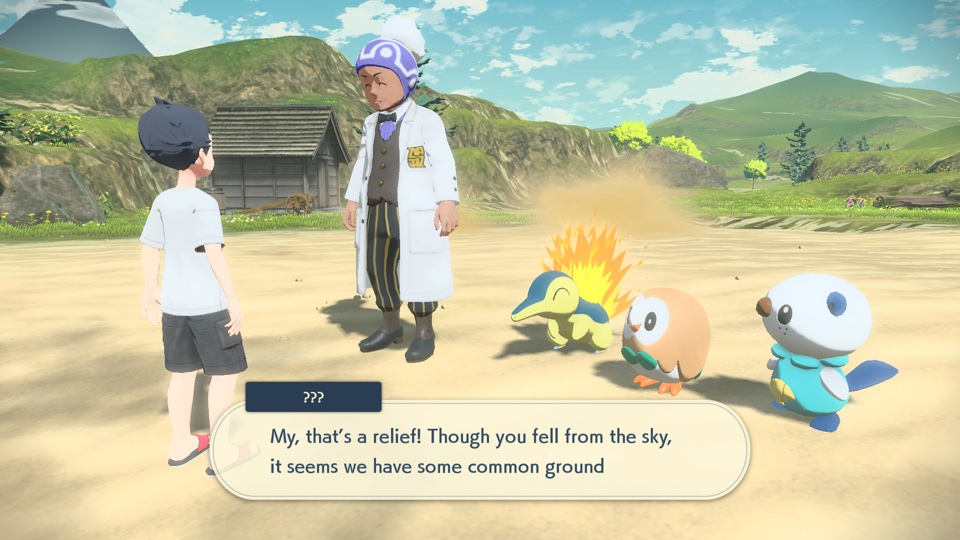</a><br><a href="dm/games/01001F5010DFA000/README.md">Pokémon Legends: Arceus</a><br><sub>~4.2 GB</sub></td>
<td align="center" valign="top" width="33%" data-title-id="0100F43008C44000"><a href="dm/games/0100F43008C44000/README.md"></a><br><a href="dm/games/0100F43008C44000/README.md">Pokémon Legends: Z-A</a><br><sub>~6 GB</sub></td>
</tr>
<tr>
<td align="center" valign="top" width="33%" data-title-id="0100A3D008C5C000"><a href="dm/games/0100A3D008C5C000/README.md"></a><br><a href="dm/games/0100A3D008C5C000/README.md">Pokémon Scarlet</a><br><sub>~7.0 GB</sub></td>
<td align="center" valign="top" width="33%" data-title-id="01008DB008C2C000"><a href="dm/games/01008DB008C2C000/README.md"></a><br><a href="dm/games/01008DB008C2C000/README.md">Pokémon Shield</a><br><sub>~12.4 GB</sub></td>
<td align="center" valign="top" width="33%" data-title-id="0100ABF008968000"><a href="dm/games/0100ABF008968000/README.md"></a><br><a href="dm/games/0100ABF008968000/README.md">Pokémon Sword</a><br><sub>~12.4 GB</sub></td>
</tr>
<tr>
<td align="center" valign="top" width="33%" data-title-id="01007BB017812000"><a href="dm/games/01007BB017812000/README.md"></a><br><a href="dm/games/01007BB017812000/README.md">Portal</a><br><sub>~2.6 GB</sub></td>
<td align="center" valign="top" width="33%" data-title-id="010020400E1C2000"><a href="dm/games/010020400E1C2000/README.md"></a><br><a href="dm/games/010020400E1C2000/README.md">Raging Loop</a><br><sub>~0.9 GB</sub></td>
<td align="center" valign="top" width="33%" data-title-id="010032E00E6E2000"><a href="dm/games/010032E00E6E2000/README.md">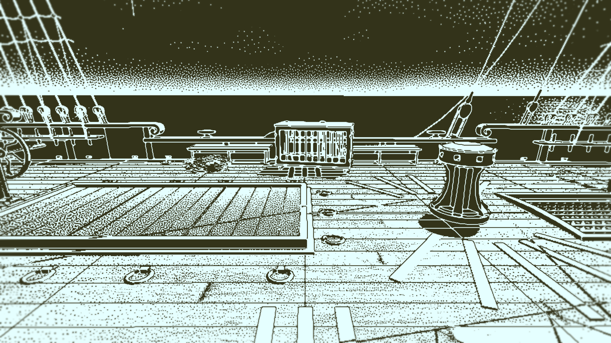</a><br><a href="dm/games/010032E00E6E2000/README.md">Return of the Obra Dinn</a><br><sub>~0.9 GB</sub></td>
</tr>
<tr>
<td align="center" valign="top" width="33%" data-title-id="0100D9F01D474000"><a href="dm/games/0100D9F01D474000/README.md"></a><br><a href="dm/games/0100D9F01D474000/README.md">Rhythm Heaven Groove</a><br><sub>~3 GB</sub></td>
<td align="center" valign="top" width="33%" data-title-id="0100C2A01A730000"><a href="dm/games/0100C2A01A730000/README.md"></a><br><a href="dm/games/0100C2A01A730000/README.md">ROMANCE OF THE THREE KINGDOMS 8 REMAKE</a><br><sub>~16.8 GB · controller only</sub></td>
<td align="center" valign="top" width="33%" data-title-id="01008C0016544000"><a href="dm/games/01008C0016544000/README.md"></a><br><a href="dm/games/01008C0016544000/README.md">Sea of Stars</a><br><sub>~5.1 GB</sub></td>
</tr>
<tr>
<td align="center" valign="top" width="33%" data-title-id="010069C01AB82000"><a href="dm/games/010069C01AB82000/README.md"></a><br><a href="dm/games/010069C01AB82000/README.md">SHIN MEGAMI TENSEI V: Vengeance</a><br><sub>~14.6 GB · 60 fps with 1.0.3</sub></td>
<td align="center" valign="top" width="33%" data-title-id="0100D5B026844000"><a href="dm/games/0100D5B026844000/README.md"></a><br><a href="dm/games/0100D5B026844000/README.md">Silver Pines</a><br><sub>Ver ficha del juego</sub></td>
<td align="center" valign="top" width="33%" data-title-id="0100E65002BB8000"><a href="dm/games/0100E65002BB8000/README.md"></a><br><a href="dm/games/0100E65002BB8000/README.md">Stardew Valley</a><br><sub>~0.6 GB</sub></td>
</tr>
<tr>
<td align="center" valign="top" width="33%" data-title-id="01008BC024FDE000"><a href="dm/games/01008BC024FDE000/README.md"></a><br><a href="dm/games/01008BC024FDE000/README.md">STEINS;GATE RE:BOOT</a><br><sub>~6 GB</sub></td>
<td align="center" valign="top" width="33%" data-title-id="010028600EBDA000"><a href="dm/games/010028600EBDA000/README.md"></a><br><a href="dm/games/010028600EBDA000/README.md">Super Mario 3D World + Bowser&#x27;s Fury</a><br><sub>~3 GB</sub></td>
<td align="center" valign="top" width="33%" data-title-id="010015100B514000"><a href="dm/games/010015100B514000/README.md"></a><br><a href="dm/games/010015100B514000/README.md">Super Mario Bros. Wonder</a><br><sub>~4 GB</sub></td>
</tr>
<tr>
<td align="center" valign="top" width="33%" data-title-id="010099C022B96000"><a href="dm/games/010099C022B96000/README.md"></a><br><a href="dm/games/010099C022B96000/README.md">Super Mario Galaxy</a><br><sub>~3 GB</sub></td>
<td align="center" valign="top" width="33%" data-title-id="0100FD8022DAA000"><a href="dm/games/0100FD8022DAA000/README.md"></a><br><a href="dm/games/0100FD8022DAA000/README.md">Super Mario Galaxy 2</a><br><sub>~3 GB</sub></td>
<td align="center" valign="top" width="33%" data-title-id="0100000000010000"><a href="dm/games/0100000000010000/README.md"></a><br><a href="dm/games/0100000000010000/README.md">Super Mario Odyssey</a><br><sub>~6 GB</sub></td>
</tr>
<tr>
<td align="center" valign="top" width="33%" data-title-id="0100965017338000"><a href="dm/games/0100965017338000/README.md">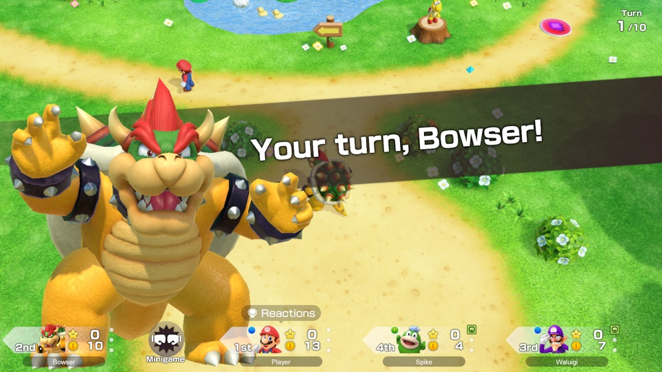</a><br><a href="dm/games/0100965017338000/README.md">Super Mario Party Jamboree</a><br><sub>Ver ficha del juego</sub></td>
<td align="center" valign="top" width="33%" data-title-id="01006A800016E000"><a href="dm/games/01006A800016E000/README.md"></a><br><a href="dm/games/01006A800016E000/README.md">Super Smash Bros. Ultimate</a><br><sub>~17.5 GB · offline</sub></td>
<td align="center" valign="top" width="33%" data-title-id="0100346017304000"><a href="dm/games/0100346017304000/README.md"></a><br><a href="dm/games/0100346017304000/README.md">Taiko Risshiden V DX</a><br><sub>~3.3 GB · Japanese · played by touch</sub></td>
</tr>
<tr>
<td align="center" valign="top" width="33%" data-title-id="010036E00FB20000"><a href="dm/games/010036E00FB20000/README.md"></a><br><a href="dm/games/010036E00FB20000/README.md">The Great Ace Attorney Chronicles</a><br><sub>~4 GB</sub></td>
<td align="center" valign="top" width="33%" data-title-id="01007EF00011E000"><a href="dm/games/01007EF00011E000/README.md"></a><br><a href="dm/games/01007EF00011E000/README.md">The Legend of Zelda: Breath of the Wild</a><br><sub>~16 GB · 60 fps with 1.9.0</sub></td>
<td align="center" valign="top" width="33%" data-title-id="01008CF01BAAC000"><a href="dm/games/01008CF01BAAC000/README.md"></a><br><a href="dm/games/01008CF01BAAC000/README.md">The Legend of Zelda: Echoes of Wisdom</a><br><sub>~7.8 GB</sub></td>
</tr>
<tr>
<td align="center" valign="top" width="33%" data-title-id="01006BB00C6F0000"><a href="dm/games/01006BB00C6F0000/README.md"></a><br><a href="dm/games/01006BB00C6F0000/README.md">The Legend of Zelda: Link&#x27;s Awakening</a><br><sub>~6 GB</sub></td>
<td align="center" valign="top" width="33%" data-title-id="0100F2C0115B6000"><a href="dm/games/0100F2C0115B6000/README.md"></a><br><a href="dm/games/0100F2C0115B6000/README.md">The Legend of Zelda: Tears of the Kingdom</a><br><sub>~17 GB · 60 fps with 1.4.3</sub></td>
<td align="center" valign="top" width="33%" data-title-id="010069401ADB8000"><a href="dm/games/010069401ADB8000/README.md"></a><br><a href="dm/games/010069401ADB8000/README.md">Unicorn Overlord</a><br><sub>~4 GB</sub></td>
</tr>
<tr>
<td align="center" valign="top" width="33%" data-title-id="010054B01AD92000"><a href="dm/games/010054B01AD92000/README.md"></a><br><a href="dm/games/010054B01AD92000/README.md">Unicorn Overlord (Asia)</a><br><sub>Unicorn Overlord~4 GB</sub></td>
<td align="center" valign="top" width="33%" data-title-id="0100E95004038000"><a href="dm/games/0100E95004038000/README.md"></a><br><a href="dm/games/0100E95004038000/README.md">Xenoblade Chronicles 2</a><br><sub>~17.1 GB</sub></td>
<td align="center" valign="top" width="33%" data-title-id="010074F013262000"><a href="dm/games/010074F013262000/README.md"></a><br><a href="dm/games/010074F013262000/README.md">Xenoblade Chronicles 3</a><br><sub>~19.2 GB</sub></td>
</tr>
<tr>
<td align="center" valign="top" width="33%" data-title-id="0100FF500E34A000"><a href="dm/games/0100FF500E34A000/README.md"></a><br><a href="dm/games/0100FF500E34A000/README.md">Xenoblade Chronicles: Definitive Edition</a><br><sub>~13.2 GB</sub></td>
<td align="center" valign="top" width="33%" data-title-id="01006000040C2000"><a href="dm/games/01006000040C2000/README.md">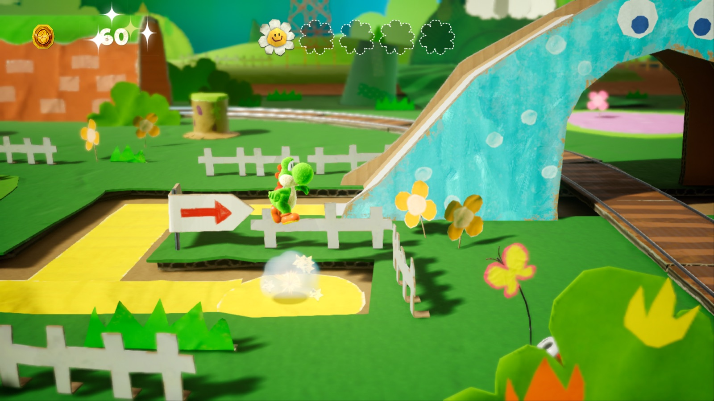</a><br><a href="dm/games/01006000040C2000/README.md">Yoshi&#x27;s Crafted World</a><br><sub>~6.1 GB</sub></td>
</tr>
</table>
<!-- END GENERATED GAME GALLERY -->

## Créditos y más

Basado en **[seedds/nxnative](https://github.com/seedds/nxnative)**, que aporta el motor, los perfiles y el trabajo de compatibilidad. **nxnative Easy** añade la biblioteca de escritorio, preparación e instalación guiadas, editor de controles táctiles y automatización. Conservamos la [licencia MIT](LICENSE), los [créditos originales](README-original.md#acknowledgements) y los avisos de terceros. Nuestras aportaciones llevan la autoría de **nalancer08**; los commits de upstream conservan sus autores.

<details>
<summary>Instalación desde código y guías técnicas</summary>

La descarga de arriba es la forma más fácil de empezar. Si prefieres compilar la interfaz desde el código, instala y abre Xcode 27.1 y ejecuta:

```bash
/bin/bash -c "$(curl -fsSL https://raw.githubusercontent.com/nalancer08/nxnative-easy/main/install.sh)"
```

¿Ya clonaste el repositorio? Abre **START-HERE.command**. Esta alternativa instala las herramientas que falten y compila la interfaz en tu Mac.

- [App portable y actualizaciones](docs/portable-desktop.md)
- [Guía de comandos](README-comandos.md)
- [Instalación y solución de problemas](docs/personal-ios.md)
- [Opciones por juego y limpieza segura](docs/game-options-and-cleanup.md)
- [Revisión de integración del motor](docs/personal-pr-review.md)
- [Desarrollo](docs/development.md) · [Sistema de diseño](docs/design-system.md)
- [README original](README-original.md)

</details>
