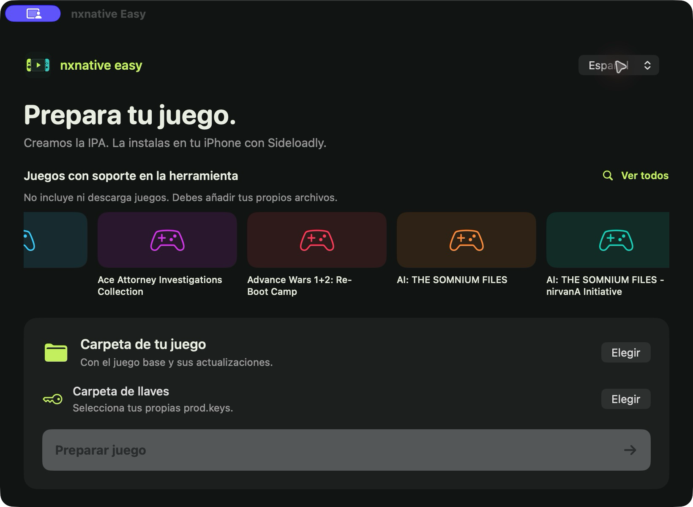
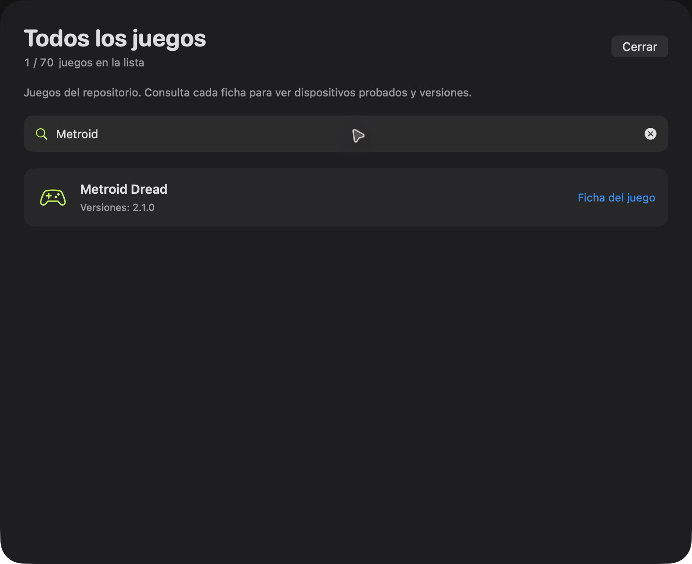

# nxnative Easy

[English](README.md) · **Español**

**Prepara tus juegos para iPhone desde una app de Mac. Sin comandos para el uso diario.**

## Qué aporta esta versión

Partimos de [seedds/nxnative](https://github.com/seedds/nxnative): el motor, los perfiles y la compatibilidad son trabajo del proyecto original. **nxnative Easy** añade:

- **App para Mac:** elegir juego, avance, cancelación y acceso a IPA, datos y Sideloadly.
- **Controles editables en iPhone:** posición, tamaño y opacidad, guardados por juego y layout.
- **IPA ligera automática:** los datos `romfs` van aparte; se conservan salidas y cachés válidas.
- **Llaves del usuario:** debes seleccionar la carpeta de tus propias `prod.keys`. No incluimos, descargamos ni distribuimos llaves o juegos.
- **Preparación local:** sin cuenta Apple, sin certificados de empresa y sin servicio que reciba tus archivos.

Entregamos **código, una interfaz de preparación y herramientas de compilación**. El resultado es una IPA sin firmar; tú la firmas e instalas con Sideloadly. No ofrecemos juegos, llaves, firma de Apple ni compatibilidad garantizada con cualquier juego.

## Idioma

La app inicia en **English**. Cambia a **Español** con el selector de la esquina superior; la elección se guarda en este Mac. Cambia el idioma de la interfaz, no el del juego. Los detalles técnicos se muestran en su idioma original.

## Abre la app y elige tu juego

1. Abre **nxnative.app**.
2. Elige la **Carpeta de tu juego**, selecciona tu **Carpeta de llaves** una vez y pulsa **Preparar juego**.

La app prepara las herramientas, compila y deja lista la **IPA ligera**. Verás el avance en la ventana. Al terminar aparecen los dos pasos para instalar. **Enviar a Sideloadly** abre allí la IPA preparada; si Sideloadly no está instalado, el botón ofrece descargarlo.

**Una vez creada:** abre `nxnative.app`. Recuerda tu última carpeta y permite volver a mostrar la IPA ya preparada.

**En otro Mac:** después de descargar este repositorio, abre [`scripts/Abrir-interfaz.command`](scripts/Abrir-interfaz.command) con doble clic. Crea y abre la app local. La primera vez necesitas Xcode completo y Homebrew instalados; si hacen falta tus llaves, te pedirá elegir la carpeta donde guardas tu propio `prod.keys`. Mantén cada juego fuera del repositorio, en una carpeta con su base y actualizaciones.

## Cómo se compila la app de Mac

El acceso de apertura usa el compilador Swift de tu Xcode. La firma de la app es **ad hoc**, local y sin cuenta, certificado ni equipo Apple (`TeamIdentifier` no asignado). No usa cuentas de empresa. Sólo al instalar la **IPA de iPhone con Sideloadly** introduces tu cuenta personal, dentro de Sideloadly.

El icono del teléfono con controles es original. Los símbolos de los perfiles son genéricos del sistema; no se usan imágenes ni logotipos de los juegos en la app. La galería de documentación de abajo procede de upstream y está separada de la interfaz.

## Instalar: Sideloadly + Finder

1. Con la IPA lista, conecta tu iPhone y pulsa **Enviar a Sideloadly**. La app abre allí el archivo preparado.
2. Dentro de Sideloadly pulsa **Start** con tu cuenta Apple **personal**. Si hace falta buscar el archivo manualmente, usa **Mostrar IPA**.
3. La primera vez, pulsa **Mostrar datos del juego** y copia la carpeta `romfs` completa por **Finder → iPhone → Archivos → tu juego**.

Para actualizar, usa la misma cuenta y el mismo bundle ID efectivo de Sideloadly. **Instala encima; no desinstales la app**, para conservar tus partidas. Si los datos del juego no cambiaron, puedes reutilizar el `romfs` existente. La app instala las herramientas de compilación que falten después de tener Xcode y Homebrew, pero **no firma ni instala el juego en el iPhone**. Esos pasos los hace Sideloadly. La app los explica cuando la IPA está lista.

## Perfiles de juegos con soporte

El carrusel muestra los perfiles de esta copia; no proporciona ni descarga juegos. Debes añadir tus propios archivos del juego. Pulsa **Ver todos** arriba a la derecha para consultar la lista completa de soporte. Busca por nombre, versión o Title ID; cada resultado enlaza a su ficha. El catálogo vuelve a leer los perfiles locales cada vez que lo abres. El carrusel rota automáticamente y se pausa al colocar el cursor encima.

**Las pruebas propias cubren compilación y empaquetado en Mac, no una verificación automática de juego en iPhone.** Los perfiles y reportes de juego proceden de upstream; revisa [la ficha de tu juego](dm/games/README.md#games) antes de prepararlo. Un perfil no garantiza que cualquier versión funcione en cualquier iPhone.

Esta base requiere iOS/iPadOS 26 o posterior, iPhone con A17 Pro o posterior o iPad con M1 o posterior. Los datos de los juegos y las llaves los aportas tú.

<table>
<tr>
<td align="center" valign="top" width="33%"> Mario Kart 8 Deluxe ~11.9 GB · no Mii heads</td>
<td align="center" valign="top" width="33%"> Mario vs. Donkey Kong ~1.6 GB</td>
<td align="center" valign="top" width="33%"> Paper Mario: The Thousand-Year Door ~5 GB · 60 fps with 1.0.1</td>
</tr>
<tr>
<td align="center" valign="top" width="33%"> Super Mario 3D World + Bowser's Fury ~3 GB</td>
<td align="center" valign="top" width="33%"> Super Mario Bros. Wonder ~4 GB</td>
<td align="center" valign="top" width="33%"> Super Mario Galaxy ~3 GB</td>
</tr>
<tr>
<td align="center" valign="top" width="33%"> Super Mario Galaxy 2 ~3 GB</td>
<td align="center" valign="top" width="33%"> Super Mario Odyssey ~6 GB</td>
<td align="center" valign="top" width="33%"> The Legend of Zelda: Breath of the Wild ~16 GB · 60 fps with 1.9.0</td>
</tr>
<tr>
<td align="center" valign="top" width="33%"> The Legend of Zelda: Link's Awakening ~6 GB</td>
<td align="center" valign="top" width="33%"> The Legend of Zelda: Tears of the Kingdom ~17 GB · 60 fps with 1.4.3</td>
<td align="center" valign="top" width="33%"> 13 Sentinels: Aegis Rim ~5 GB</td>
</tr>
<tr>
<td align="center" valign="top" width="33%"> Absolum ~2 GB</td>
<td align="center" valign="top" width="33%"> Ace Attorney Investigations Collection ~7 GB</td>
<td align="center" valign="top" width="33%"> Advance Wars 1+2: Re-Boot Camp ~7.1 GB</td>
</tr>
<tr>
<td align="center" valign="top" width="33%"> AI: THE SOMNIUM FILES ~8.3 GB</td>
<td align="center" valign="top" width="33%"> AI: THE SOMNIUM FILES - nirvanA Initiative ~11.6 GB</td>
<td align="center" valign="top" width="33%"> Animal Crossing: New Horizons ~10.5 GB</td>
</tr>
<tr>
<td align="center" valign="top" width="33%"> ANIMAL WELL ~54 MB</td>
<td align="center" valign="top" width="33%"> <a href="dm/games/01007300020FA000/README.md">ASTRAL CHAIN</a> ~9.7 GB · 60 fps target with 1.0.1</td>
<td align="center" valign="top" width="33%"> Balatro ~82 MB · played by touch</td>
</tr>
<tr>
<td align="center" valign="top" width="33%"> BALL x PIT ~1.1 GB</td>
<td align="center" valign="top" width="33%"> Bayonetta ~8.8 GB</td>
<td align="center" valign="top" width="33%"> Bayonetta 2 ~12.5 GB</td>
</tr>
<tr>
<td align="center" valign="top" width="33%"> Bayonetta 3 ~14.2 GB</td>
<td align="center" valign="top" width="33%"> Big Brain Academy: Brain vs. Brain ~0.8 GB</td>
<td align="center" valign="top" width="33%"> Brain Memory Training Academy ~0.1 GB</td>
</tr>
<tr>
<td align="center" valign="top" width="33%"> Captain Toad: Treasure Tracker ~2 GB</td>
<td align="center" valign="top" width="33%"> Catherine: Full Body ~14 GB</td>
<td align="center" valign="top" width="33%"> Celeste ~0.9 GB</td>
</tr>
<tr>
<td align="center" valign="top" width="33%"> Cuphead ~5 GB</td>
<td align="center" valign="top" width="33%"> DARK SOULS: REMASTERED ~4 GB · 60 fps with 1.0.3</td>
<td align="center" valign="top" width="33%"> Digimon Story Cyber Sleuth: Complete Edition ~5 GB</td>
</tr>
<tr>
<td align="center" valign="top" width="33%"> DRAGON QUEST VII Reimagined ~5.9 GB</td>
<td align="center" valign="top" width="33%"> DRAGON QUEST XI S: Echoes of an Elusive Age – Definitive Edition ~15 GB · 60 fps with 1.0.4</td>
<td align="center" valign="top" width="33%"> FINAL FANTASY RESONANCE ~10 GB · 60 fps with 1.0.1</td>
</tr>
<tr>
<td align="center" valign="top" width="33%"> FINAL FANTASY TACTICS - The Ivalice Chronicles ~11 GB</td>
<td align="center" valign="top" width="33%"> Fire Emblem Engage ~15 GB · 60 fps with 2.0.0</td>
<td align="center" valign="top" width="33%"> Fire Emblem: Three Houses ~13 GB · 60 fps with 1.2.0</td>
</tr>
<tr>
<td align="center" valign="top" width="33%"> Ghost Trick: Phantom Detective ~3 GB</td>
<td align="center" valign="top" width="33%"> The Great Ace Attorney Chronicles ~4 GB</td>
<td align="center" valign="top" width="33%"> Hades ~4 GB</td>
</tr>
<tr>
<td align="center" valign="top" width="33%"> Hades II ~4 GB</td>
<td align="center" valign="top" width="33%"> Hollow Knight: Silksong ~6.4 GB</td>
<td align="center" valign="top" width="33%"> Hyrule Warriors: Age of Calamity ~15 GB · 60 fps with 1.3.0</td>
</tr>
<tr>
<td align="center" valign="top" width="33%"> Luigi's Mansion 3 ~7.5 GB · 60 fps with 1.4.0</td>
<td align="center" valign="top" width="33%"> Metroid Dread ~5 GB</td>
<td align="center" valign="top" width="33%"> Monster Hunter Rise ~22 GB · 60 fps with 16.0.2</td>
</tr>
<tr>
<td align="center" valign="top" width="33%"> Monster Train 2 ~1.6 GB · 60 fps with 1.1.1</td>
<td align="center" valign="top" width="33%"> Octopath Traveler 0 ~4 GB · 60 fps with 1.0.5</td>
<td align="center" valign="top" width="33%"> Octopath Traveler II ~5.9 GB · 60 fps with 1.1.1</td>
</tr>
<tr>
<td align="center" valign="top" width="33%"> Patrick's Parabox ~0.2 GB</td>
<td align="center" valign="top" width="33%"> Persona 5 Royal ~14.9 GB</td>
<td align="center" valign="top" width="33%"> Pikmin 4 ~10.8 GB</td>
</tr>
<tr>
<td align="center" valign="top" width="33%"> Pokémon Brilliant Diamond ~4.6 GB · 60 fps with 1.3.0</td>
<td align="center" valign="top" width="33%"> Pokémon Legends: Z-A ~6 GB</td>
<td align="center" valign="top" width="33%"> Pokémon Sword ~12.4 GB</td>
</tr>
<tr>
<td align="center" valign="top" width="33%"> Pokémon Shield ~12.4 GB</td>
<td align="center" valign="top" width="33%"> Portal ~2.6 GB</td>
<td align="center" valign="top" width="33%"> Raging Loop ~0.9 GB</td>
</tr>
<tr>
<td align="center" valign="top" width="33%"> Rhythm Heaven Groove ~3 GB</td>
<td align="center" valign="top" width="33%"> ROMANCE OF THE THREE KINGDOMS 8 REMAKE ~16.8 GB · controller only</td>
<td align="center" valign="top" width="33%"> Stardew Valley ~0.6 GB</td>
</tr>
<tr>
<td align="center" valign="top" width="33%"> STEINS;GATE RE:BOOT ~6 GB</td>
<td align="center" valign="top" width="33%"> Super Smash Bros. Ultimate ~17.5 GB · offline</td>
<td align="center" valign="top" width="33%"> Taiko Risshiden V DX ~3.3 GB · Japanese · played by touch</td>
</tr>
<tr>
<td align="center" valign="top" width="33%"> Unicorn Overlord ~4 GB</td>
<td align="center" valign="top" width="33%"> NieR:Automata The End of YoRHa Edition ~10.9 GB · 60 fps with 1.0.3</td>
<td align="center" valign="top" width="33%"> The Legend of Zelda: Echoes of Wisdom ~7.8 GB</td>
</tr>
</table>

## Controles a tu gusto

En el juego pulsa **Edit controls**. Mueve los botones, ajusta tamaño y opacidad y pulsa **Save**. **Cancel** descarta y **Reset control / Reset all** restaura. Cada juego guarda su acomodo 2D y 3D. El juego sigue corriendo mientras editas. El selector de idioma de la app de Mac no traduce este editor dentro del juego.

Guías, comandos y detalles técnicos

- [Guía de comandos e instalación detallada](README-comandos.md).
- [Automatización y solución de problemas](docs/personal-ios.md).
- [Revisión de los PR de upstream](docs/personal-pr-review.md).
- [README anterior y créditos completos](README-original.md).

Basado en [seedds/nxnative](https://github.com/seedds/nxnative), con nuestro editor de controles y automatización. Conservamos la [licencia MIT](LICENSE) y los [créditos originales](README-original.md#acknowledgements). Nuestros cambios pertenecen a la cuenta de GitHub **nalancer08**; los commits históricos de upstream conservan su autoría.
