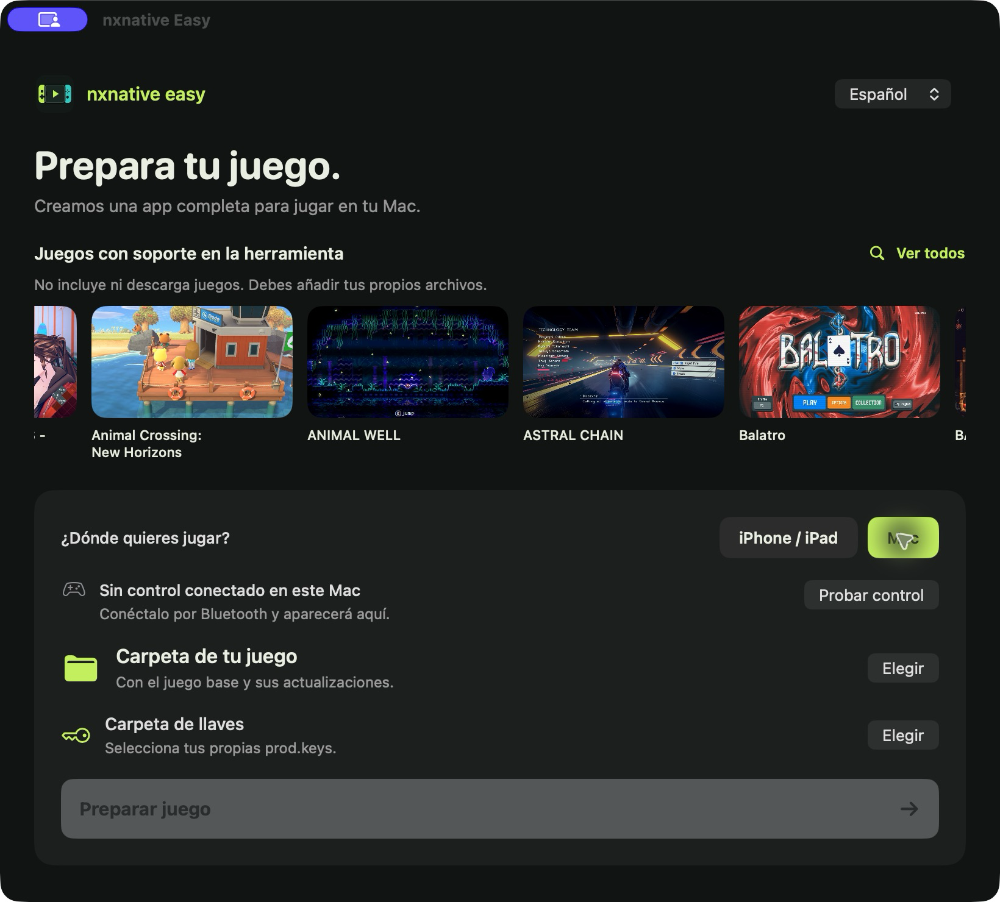
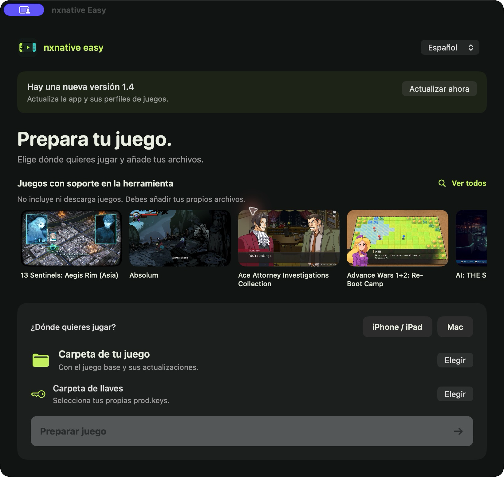
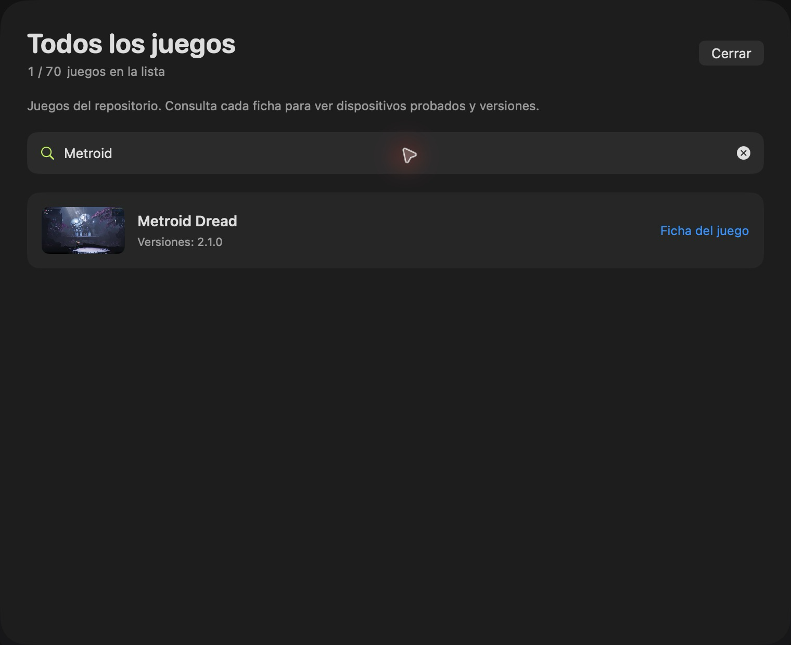
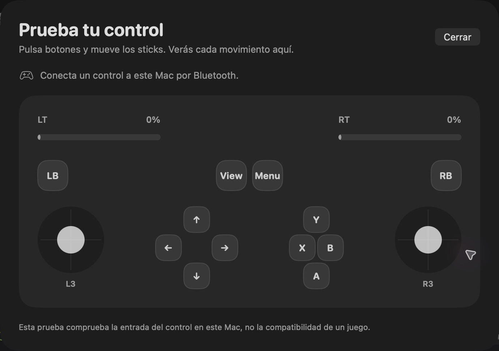

# nxnative Easy

[English](README.md) · **Español**

**Ejecuta tus propios juegos compatibles de Nintendo Switch de forma nativa en Mac, iPhone y iPad, con gráficos Metal, controles físicos y controles táctiles editables.**

## Empieza aquí

**Primero:** instala [Xcode](https://apps.apple.com/app/xcode/id497799835) completo desde App Store y ábrelo una vez. **Xcode también compila los juegos**; una interfaz ya compilada no elimina ese requisito.

**Después:** pega este único comando en Terminal:

```bash
/bin/bash -c "$(curl -fsSL https://raw.githubusercontent.com/nalancer08/nxnative-easy/main/install.sh)"
```

Descarga nxnative Easy, instala Homebrew y las herramientas que falten, **compila tu interfaz de Mac y la abre**. Sigue las cuatro etapas numeradas y las solicitudes de contraseña o confirmación que aparezcan en Terminal. No usa una cuenta de desarrollador Apple. Si repites la instalación, verifica la app nueva antes de sustituir la existente y guarda la anterior como respaldo.

**¿Ya descargaste el repositorio?** Abre **START-HERE.command** en la carpeta principal con doble clic. Hace la misma preparación; no necesitas buscar scripts dentro de `scripts/`. Si macOS bloquea ese archivo, usa el comando de arriba.

Cuando abra la app:

1. Elige **iPhone / iPad** o **Mac**.
2. Selecciona la **carpeta de tu juego** y la **carpeta de tus llaves**.
3. Pulsa **Preparar juego**.

**Las siguientes veces:** abre **nxnative Easy.app** en la carpeta **Aplicaciones de tu usuario**. La preparación conserva su propia copia del código; puedes borrar el ZIP y la carpeta que descargaste.

**Mac:** crea una sola `.app` completa, con todos los datos del juego dentro; pulsa **Abrir juego**. No necesitas copiar una carpeta RomFS aparte. No necesitas Sideloadly ni un iPhone. Las partidas quedan en `~/Library/Application Support/nxnative/<title ID>/`.

**iPhone / iPad:** crea una IPA ligera sin firmar. Instálala con Sideloadly y copia los datos del juego como te indica la app. [Ver pantalla de preparación para iPhone/iPad](docs/images/nxnative-ios-es-v1.4.png).

**Necesitas:** Mac con Apple silicon (M1 o posterior), macOS 26+ y Xcode 26+. El comando instala las otras herramientas. Los juegos y las llaves los aportas tú. La primera compilación puede tardar.



## Qué aporta esta versión

Partimos de [seedds/nxnative](https://github.com/seedds/nxnative): el motor, los perfiles y la compatibilidad son trabajo del proyecto original. **nxnative Easy** añade:

- **App para Mac:** elegir juego, avance, cancelación y acceso a IPA, datos y Sideloadly.
- **Controles editables en iPhone:** posición, tamaño y opacidad, guardados por juego y layout.
- **IPA ligera sólo para iPhone/iPad:** los datos `romfs` van aparte; se conservan salidas y cachés válidas.
- **Llaves del usuario:** debes seleccionar la carpeta de tus propias `prod.keys`. No incluimos, descargamos ni distribuimos llaves o juegos.
- **Preparación local:** sin cuenta Apple, sin certificados de empresa y sin servicio que reciba tus archivos.

Entregamos **código, una interfaz de preparación y herramientas de compilación**. El resultado es una app local para Mac o una IPA para iPhone/iPad sin firmar, que firmas e instalas con Sideloadly. No ofrecemos juegos, llaves, firma de Apple ni compatibilidad garantizada con cualquier juego.

## Actualizaciones del motor y multijugador

Nuestro main incorpora la revisión del original registrada en el [informe de integración](docs/personal-pr-review.md). Las siguientes actualizaciones del motor se integran y prueban en una copia separada, conservando nuestra interfaz y controles. Cada juego aceptado se sincroniza en la app, imágenes, fichas y ambas galerías del README; CI comprueba que no falte ninguno. **Actualizar ahora** instala nuestras versiones probadas, no cambios del original sin revisar.

El motor actual funciona **sin conexión**. No admite los servicios en línea de Nintendo, LAN/netplay ni Windows. Una suscripción a Nintendo Switch Online no los activa aquí. Usar varios controles en un mismo Mac es una función distinta. [Cómo funcionan el código, los mods y la red](docs/development.md#game-binaries-mods-and-networking).

## Idioma

La app inicia en **English**. Cambia a **Español** con el selector de la esquina superior; la elección se guarda en este Mac. Cambia el idioma de la interfaz, no el del juego. Los detalles técnicos se muestran en su idioma original.

## Actualizar la app

Desde la **versión 1.4**, la app busca versiones nuevas al abrirse y cada seis horas mientras está abierta. Cuando haya una, pulsa **Actualizar ahora**. Descarga el código y los perfiles nuevos, compila y verifica la interfaz y la reinicia. Verás el avance dentro de la ventana. También puedes usar **nxnative Easy → Buscar actualizaciones…**.

La actualización usa una carpeta separada y guarda la app anterior como respaldo. No restablece tu checkout ni modifica tus juegos, llaves o partidas. No se puede actualizar mientras se prepara un juego. Para aplicar cambios del motor o de un perfil a un juego que ya habías preparado, vuelve a prepararlo.



**¿Tienes la versión 1.3 o anterior?** Ejecuta una vez el comando de arriba o abre **START-HERE.command**. Las siguientes actualizaciones ya aparecerán dentro de la app.

## ¿Qué pasa al pulsar Preparar juego?

La app prepara las herramientas y compila para el dispositivo que elegiste. **Mac** genera una app del juego con los botones **Abrir juego** y **Mostrar app**. **iPhone / iPad** genera una IPA ligera y muestra los pasos de Sideloadly y Finder al terminar. Tus archivos y salidas anteriores se conservan en la carpeta del juego.

La preparación conserva una copia separada del código y respeta los cambios locales. Para desarrollo sigue disponible [`scripts/Abrir-interfaz.command`](scripts/Abrir-interfaz.command).

## Cómo se compila la app de Mac

El acceso de apertura usa el compilador Swift de tu Xcode. La firma de la app es **ad hoc**, local y sin cuenta, certificado ni equipo Apple (`TeamIdentifier` no asignado). No usa cuentas de empresa. Sólo al instalar la **IPA de iPhone con Sideloadly** introduces tu cuenta personal, dentro de Sideloadly.

El icono del teléfono con controles es original. Las tarjetas usan las capturas de upstream que ya están en este repositorio como referencia de soporte; no proporcionan ni descargan juegos.

## Instalar: Sideloadly + Finder

1. Con la IPA lista, conecta tu iPhone y pulsa **Enviar a Sideloadly**. La app abre allí el archivo preparado.
2. Dentro de Sideloadly pulsa **Start** con tu cuenta Apple **personal**. Si hace falta buscar el archivo manualmente, usa **Mostrar IPA**.
3. La primera vez, pulsa **Mostrar datos del juego** y copia la carpeta `romfs` completa por **Finder → iPhone → Archivos → tu juego**.

Para actualizar, usa la misma cuenta y el mismo bundle ID efectivo de Sideloadly. **Instala encima; no desinstales la app**, para conservar tus partidas. Si los datos del juego no cambiaron, puedes reutilizar el `romfs` existente. La app instala las herramientas de compilación que falten después de tener Xcode y Homebrew, pero **no firma ni instala el juego en el iPhone**. Esos pasos los hace Sideloadly. La app los explica cuando la IPA está lista.

## Perfiles de juegos con soporte

El carrusel muestra los perfiles de esta copia; no proporciona ni descarga juegos. Debes añadir tus propios archivos del juego. Pulsa **Ver todos** arriba a la derecha para consultar la lista completa de soporte. Busca por nombre, versión o Title ID; cada resultado enlaza a su ficha. El catálogo vuelve a leer los perfiles locales cada vez que lo abres. El carrusel rota automáticamente y se pausa al colocar el cursor encima.



**Las pruebas propias cubren compilación y empaquetado en Mac, no una verificación automática de juego en iPhone.** Los perfiles y reportes de juego proceden de upstream; revisa [la ficha de tu juego](dm/games/README.md#games) antes de prepararlo. Un perfil no garantiza que cualquier versión funcione en cualquier iPhone.

Esta base requiere iOS/iPadOS 26 o posterior, iPhone con A17 Pro o posterior o iPad con M1 o posterior. Los datos de los juegos y las llaves los aportas tú.

<!-- BEGIN GENERATED GAME GALLERY -->
78 perfiles. Consulta la ficha de cada juego para ver versiones y dispositivos probados.

<table>
<tr>
<td align="center" valign="top" width="33%" data-title-id="01003FC01670C000"><a href="dm/games/01003FC01670C000/README.md"></a><br><a href="dm/games/01003FC01670C000/README.md">13 Sentinels: Aegis Rim</a><br><sub>~5 GB</sub></td>
<td align="center" valign="top" width="33%" data-title-id="01008D7016438000"><a href="dm/games/01008D7016438000/README.md"></a><br><a href="dm/games/01008D7016438000/README.md">13 Sentinels: Aegis Rim (Asia)</a><br><sub>~5 GB</sub></td>
<td align="center" valign="top" width="33%" data-title-id="0100A83022A22000"><a href="dm/games/0100A83022A22000/README.md"></a><br><a href="dm/games/0100A83022A22000/README.md">Absolum</a><br><sub>~2 GB</sub></td>
</tr>
<tr>
<td align="center" valign="top" width="33%" data-title-id="010005501E68C000"><a href="dm/games/010005501E68C000/README.md"></a><br><a href="dm/games/010005501E68C000/README.md">Ace Attorney Investigations Collection</a><br><sub>~7 GB</sub></td>
<td align="center" valign="top" width="33%" data-title-id="0100300012F2A000"><a href="dm/games/0100300012F2A000/README.md"></a><br><a href="dm/games/0100300012F2A000/README.md">Advance Wars 1+2: Re-Boot Camp</a><br><sub>~7.1 GB</sub></td>
<td align="center" valign="top" width="33%" data-title-id="010089B00D09C000"><a href="dm/games/010089B00D09C000/README.md"></a><br><a href="dm/games/010089B00D09C000/README.md">AI: THE SOMNIUM FILES</a><br><sub>~8.3 GB</sub></td>
</tr>
<tr>
<td align="center" valign="top" width="33%" data-title-id="0100713016CCC000"><a href="dm/games/0100713016CCC000/README.md"></a><br><a href="dm/games/0100713016CCC000/README.md">AI: THE SOMNIUM FILES - nirvanA Initiative</a><br><sub>~11.6 GB</sub></td>
<td align="center" valign="top" width="33%" data-title-id="01006F8002326000"><a href="dm/games/01006F8002326000/README.md"></a><br><a href="dm/games/01006F8002326000/README.md">Animal Crossing: New Horizons</a><br><sub>~10.5 GB</sub></td>
<td align="center" valign="top" width="33%" data-title-id="010020D01AD24000"><a href="dm/games/010020D01AD24000/README.md"></a><br><a href="dm/games/010020D01AD24000/README.md">ANIMAL WELL</a><br><sub>~54 MB</sub></td>
</tr>
<tr>
<td align="center" valign="top" width="33%" data-title-id="01007300020FA000"><a href="dm/games/01007300020FA000/README.md"></a><br><a href="dm/games/01007300020FA000/README.md">ASTRAL CHAIN</a><br><sub>~9.7 GB · 60 fps target with 1.0.1</sub></td>
<td align="center" valign="top" width="33%" data-title-id="0100CD801CE5E000"><a href="dm/games/0100CD801CE5E000/README.md"></a><br><a href="dm/games/0100CD801CE5E000/README.md">Balatro</a><br><sub>~82 MB · played by touch</sub></td>
<td align="center" valign="top" width="33%" data-title-id="010086A022444000"><a href="dm/games/010086A022444000/README.md"></a><br><a href="dm/games/010086A022444000/README.md">BALL x PIT</a><br><sub>~1.1 GB</sub></td>
</tr>
<tr>
<td align="center" valign="top" width="33%" data-title-id="010076F0049A2000"><a href="dm/games/010076F0049A2000/README.md"></a><br><a href="dm/games/010076F0049A2000/README.md">Bayonetta</a><br><sub>~8.8 GB</sub></td>
<td align="center" valign="top" width="33%" data-title-id="01007960049A0000"><a href="dm/games/01007960049A0000/README.md"></a><br><a href="dm/games/01007960049A0000/README.md">Bayonetta 2</a><br><sub>~12.5 GB</sub></td>
<td align="center" valign="top" width="33%" data-title-id="01004A4010FEA000"><a href="dm/games/01004A4010FEA000/README.md"></a><br><a href="dm/games/01004A4010FEA000/README.md">Bayonetta 3</a><br><sub>~14.2 GB</sub></td>
</tr>
<tr>
<td align="center" valign="top" width="33%" data-title-id="0100620012D6E000"><a href="dm/games/0100620012D6E000/README.md"></a><br><a href="dm/games/0100620012D6E000/README.md">Big Brain Academy: Brain vs. Brain</a><br><sub>~0.8 GB</sub></td>
<td align="center" valign="top" width="33%" data-title-id="0100F5D01DA3A000"><a href="dm/games/0100F5D01DA3A000/README.md"></a><br><a href="dm/games/0100F5D01DA3A000/README.md">Brain Memory Training Academy</a><br><sub>~0.1 GB</sub></td>
<td align="center" valign="top" width="33%" data-title-id="01009BF0072D4000"><a href="dm/games/01009BF0072D4000/README.md"></a><br><a href="dm/games/01009BF0072D4000/README.md">Captain Toad: Treasure Tracker</a><br><sub>~2 GB</sub></td>
</tr>
<tr>
<td align="center" valign="top" width="33%" data-title-id="0100BF00112C0000"><a href="dm/games/0100BF00112C0000/README.md"></a><br><a href="dm/games/0100BF00112C0000/README.md">Catherine: Full Body</a><br><sub>~14 GB</sub></td>
<td align="center" valign="top" width="33%" data-title-id="01002B30028F6000"><a href="dm/games/01002B30028F6000/README.md"></a><br><a href="dm/games/01002B30028F6000/README.md">Celeste</a><br><sub>~0.9 GB</sub></td>
<td align="center" valign="top" width="33%" data-title-id="0100A5C00D162000"><a href="dm/games/0100A5C00D162000/README.md"></a><br><a href="dm/games/0100A5C00D162000/README.md">Cuphead</a><br><sub>~5 GB</sub></td>
</tr>
<tr>
<td align="center" valign="top" width="33%" data-title-id="01004AB00A260000"><a href="dm/games/01004AB00A260000/README.md"></a><br><a href="dm/games/01004AB00A260000/README.md">DARK SOULS: REMASTERED</a><br><sub>~4 GB · 60 fps with 1.0.3</sub></td>
<td align="center" valign="top" width="33%" data-title-id="010014E00DB56000"><a href="dm/games/010014E00DB56000/README.md"></a><br><a href="dm/games/010014E00DB56000/README.md">Digimon Story Cyber Sleuth: Complete Edition</a><br><sub>~5 GB</sub></td>
<td align="center" valign="top" width="33%" data-title-id="01009D901BC56000"><a href="dm/games/01009D901BC56000/README.md"></a><br><a href="dm/games/01009D901BC56000/README.md">Donkey Kong Country Returns HD</a><br><sub>~11.6 GB</sub></td>
</tr>
<tr>
<td align="center" valign="top" width="33%" data-title-id="0100C1F0051B6000"><a href="dm/games/0100C1F0051B6000/README.md"></a><br><a href="dm/games/0100C1F0051B6000/README.md">Donkey Kong Country: Tropical Freeze</a><br><sub>~7.3 GB</sub></td>
<td align="center" valign="top" width="33%" data-title-id="0100A9D01C446000"><a href="dm/games/0100A9D01C446000/README.md"></a><br><a href="dm/games/0100A9D01C446000/README.md">DRAGON QUEST VII Reimagined</a><br><sub>~5.9 GB</sub></td>
<td align="center" valign="top" width="33%" data-title-id="01006C300E9F0000"><a href="dm/games/01006C300E9F0000/README.md"></a><br><a href="dm/games/01006C300E9F0000/README.md">DRAGON QUEST XI S: Echoes of an Elusive Age – Definitive Edition</a><br><sub>~15 GB · 60 fps with 1.0.4</sub></td>
</tr>
<tr>
<td align="center" valign="top" width="33%" data-title-id="0100606026F12000"><a href="dm/games/0100606026F12000/README.md"></a><br><a href="dm/games/0100606026F12000/README.md">FINAL FANTASY RESONANCE</a><br><sub>~10 GB · 60 fps with 1.0.1</sub></td>
<td align="center" valign="top" width="33%" data-title-id="010038B015560000"><a href="dm/games/010038B015560000/README.md"></a><br><a href="dm/games/010038B015560000/README.md">FINAL FANTASY TACTICS - The Ivalice Chronicles</a><br><sub>~11 GB</sub></td>
<td align="center" valign="top" width="33%" data-title-id="0100A6301214E000"><a href="dm/games/0100A6301214E000/README.md"></a><br><a href="dm/games/0100A6301214E000/README.md">Fire Emblem Engage</a><br><sub>~15 GB · 60 fps with 2.0.0</sub></td>
</tr>
<tr>
<td align="center" valign="top" width="33%" data-title-id="010055D009F78000"><a href="dm/games/010055D009F78000/README.md"></a><br><a href="dm/games/010055D009F78000/README.md">Fire Emblem: Three Houses</a><br><sub>~13 GB · 60 fps with 1.2.0</sub></td>
<td align="center" valign="top" width="33%" data-title-id="010029B018432000"><a href="dm/games/010029B018432000/README.md"></a><br><a href="dm/games/010029B018432000/README.md">Ghost Trick: Phantom Detective</a><br><sub>~3 GB</sub></td>
<td align="center" valign="top" width="33%" data-title-id="0100535012974000"><a href="dm/games/0100535012974000/README.md"></a><br><a href="dm/games/0100535012974000/README.md">Hades</a><br><sub>~4 GB</sub></td>
</tr>
<tr>
<td align="center" valign="top" width="33%" data-title-id="0100A00019DE0000"><a href="dm/games/0100A00019DE0000/README.md"></a><br><a href="dm/games/0100A00019DE0000/README.md">Hades II</a><br><sub>~4 GB</sub></td>
<td align="center" valign="top" width="33%" data-title-id="010013C00E930000"><a href="dm/games/010013C00E930000/README.md"></a><br><a href="dm/games/010013C00E930000/README.md">Hollow Knight: Silksong</a><br><sub>~6.4 GB</sub></td>
<td align="center" valign="top" width="33%" data-title-id="01002B00111A2000"><a href="dm/games/01002B00111A2000/README.md"></a><br><a href="dm/games/01002B00111A2000/README.md">Hyrule Warriors: Age of Calamity</a><br><sub>~15 GB · 60 fps with 1.3.0</sub></td>
</tr>
<tr>
<td align="center" valign="top" width="33%" data-title-id="01004D300C5AE000"><a href="dm/games/01004D300C5AE000/README.md"></a><br><a href="dm/games/01004D300C5AE000/README.md">Kirby and the Forgotten Land</a><br><sub>~6.4 GB</sub></td>
<td align="center" valign="top" width="33%" data-title-id="0100DCA0064A6000"><a href="dm/games/0100DCA0064A6000/README.md"></a><br><a href="dm/games/0100DCA0064A6000/README.md">Luigi&#x27;s Mansion 3</a><br><sub>~7.5 GB · 60 fps with 1.4.0</sub></td>
<td align="center" valign="top" width="33%" data-title-id="0100152000022000"><a href="dm/games/0100152000022000/README.md"></a><br><a href="dm/games/0100152000022000/README.md">Mario Kart 8 Deluxe</a><br><sub>~11.9 GB · no Mii heads</sub></td>
</tr>
<tr>
<td align="center" valign="top" width="33%" data-title-id="0100317013770000"><a href="dm/games/0100317013770000/README.md"></a><br><a href="dm/games/0100317013770000/README.md">Mario + Rabbids® Sparks of Hope</a><br><sub>~9.8 GB</sub></td>
<td align="center" valign="top" width="33%" data-title-id="0100B99019412000"><a href="dm/games/0100B99019412000/README.md"></a><br><a href="dm/games/0100B99019412000/README.md">Mario vs. Donkey Kong</a><br><sub>~1.6 GB</sub></td>
<td align="center" valign="top" width="33%" data-title-id="010093801237C000"><a href="dm/games/010093801237C000/README.md"></a><br><a href="dm/games/010093801237C000/README.md">Metroid Dread</a><br><sub>~5 GB</sub></td>
</tr>
<tr>
<td align="center" valign="top" width="33%" data-title-id="0100B04011742000"><a href="dm/games/0100B04011742000/README.md"></a><br><a href="dm/games/0100B04011742000/README.md">Monster Hunter Rise</a><br><sub>~22 GB · 60 fps with 16.0.2</sub></td>
<td align="center" valign="top" width="33%" data-title-id="010051701FB46000"><a href="dm/games/010051701FB46000/README.md"></a><br><a href="dm/games/010051701FB46000/README.md">Monster Train 2</a><br><sub>~1.6 GB · 60 fps with 1.1.1</sub></td>
<td align="center" valign="top" width="33%" data-title-id="010056B015FE8000"><a href="dm/games/010056B015FE8000/README.md"></a><br><a href="dm/games/010056B015FE8000/README.md">NieR:Automata The End of YoRHa Edition</a><br><sub>~10.9 GB · 60 fps with 1.0.3</sub></td>
</tr>
<tr>
<td align="center" valign="top" width="33%" data-title-id="010057D006492000"><a href="dm/games/010057D006492000/README.md"></a><br><a href="dm/games/010057D006492000/README.md">OCTOPATH TRAVELER</a><br><sub>~3.6 GB</sub></td>
<td align="center" valign="top" width="33%" data-title-id="01005270232F2000"><a href="dm/games/01005270232F2000/README.md"></a><br><a href="dm/games/01005270232F2000/README.md">OCTOPATH TRAVELER 0</a><br><sub>~4 GB · 60 fps with 1.0.5</sub></td>
<td align="center" valign="top" width="33%" data-title-id="0100A3501946E000"><a href="dm/games/0100A3501946E000/README.md"></a><br><a href="dm/games/0100A3501946E000/README.md">OCTOPATH TRAVELER II</a><br><sub>~5.9 GB · 60 fps with 1.1.1</sub></td>
</tr>
<tr>
<td align="center" valign="top" width="33%" data-title-id="0100ECD018EBE000"><a href="dm/games/0100ECD018EBE000/README.md"></a><br><a href="dm/games/0100ECD018EBE000/README.md">Paper Mario: The Thousand-Year Door</a><br><sub>~5 GB · 60 fps with 1.0.1</sub></td>
<td align="center" valign="top" width="33%" data-title-id="0100E44016C22000"><a href="dm/games/0100E44016C22000/README.md"></a><br><a href="dm/games/0100E44016C22000/README.md">Patrick&#x27;s Parabox</a><br><sub>~0.2 GB</sub></td>
<td align="center" valign="top" width="33%" data-title-id="01005CA01580E000"><a href="dm/games/01005CA01580E000/README.md"></a><br><a href="dm/games/01005CA01580E000/README.md">Persona 5 Royal</a><br><sub>~14.9 GB</sub></td>
</tr>
<tr>
<td align="center" valign="top" width="33%" data-title-id="0100B7C00933A000"><a href="dm/games/0100B7C00933A000/README.md"></a><br><a href="dm/games/0100B7C00933A000/README.md">Pikmin 4</a><br><sub>~10.8 GB</sub></td>
<td align="center" valign="top" width="33%" data-title-id="0100000011D90000"><a href="dm/games/0100000011D90000/README.md"></a><br><a href="dm/games/0100000011D90000/README.md">Pokémon Brilliant Diamond</a><br><sub>~4.6 GB · 60 fps with 1.3.0</sub></td>
<td align="center" valign="top" width="33%" data-title-id="0100F43008C44000"><a href="dm/games/0100F43008C44000/README.md"></a><br><a href="dm/games/0100F43008C44000/README.md">Pokémon Legends: Z-A</a><br><sub>~6 GB</sub></td>
</tr>
<tr>
<td align="center" valign="top" width="33%" data-title-id="01008DB008C2C000"><a href="dm/games/01008DB008C2C000/README.md"></a><br><a href="dm/games/01008DB008C2C000/README.md">Pokémon Shield</a><br><sub>~12.4 GB</sub></td>
<td align="center" valign="top" width="33%" data-title-id="0100ABF008968000"><a href="dm/games/0100ABF008968000/README.md"></a><br><a href="dm/games/0100ABF008968000/README.md">Pokémon Sword</a><br><sub>~12.4 GB</sub></td>
<td align="center" valign="top" width="33%" data-title-id="01007BB017812000"><a href="dm/games/01007BB017812000/README.md"></a><br><a href="dm/games/01007BB017812000/README.md">Portal</a><br><sub>~2.6 GB</sub></td>
</tr>
<tr>
<td align="center" valign="top" width="33%" data-title-id="010020400E1C2000"><a href="dm/games/010020400E1C2000/README.md"></a><br><a href="dm/games/010020400E1C2000/README.md">Raging Loop</a><br><sub>~0.9 GB</sub></td>
<td align="center" valign="top" width="33%" data-title-id="0100D9F01D474000"><a href="dm/games/0100D9F01D474000/README.md"></a><br><a href="dm/games/0100D9F01D474000/README.md">Rhythm Heaven Groove</a><br><sub>~3 GB</sub></td>
<td align="center" valign="top" width="33%" data-title-id="0100C2A01A730000"><a href="dm/games/0100C2A01A730000/README.md"></a><br><a href="dm/games/0100C2A01A730000/README.md">ROMANCE OF THE THREE KINGDOMS 8 REMAKE</a><br><sub>~16.8 GB · controller only</sub></td>
</tr>
<tr>
<td align="center" valign="top" width="33%" data-title-id="01008C0016544000"><a href="dm/games/01008C0016544000/README.md"></a><br><a href="dm/games/01008C0016544000/README.md">Sea of Stars</a><br><sub>~5.1 GB</sub></td>
<td align="center" valign="top" width="33%" data-title-id="010069C01AB82000"><a href="dm/games/010069C01AB82000/README.md"></a><br><a href="dm/games/010069C01AB82000/README.md">SHIN MEGAMI TENSEI V: Vengeance</a><br><sub>~14.6 GB · 60 fps with 1.0.3</sub></td>
<td align="center" valign="top" width="33%" data-title-id="0100E65002BB8000"><a href="dm/games/0100E65002BB8000/README.md"></a><br><a href="dm/games/0100E65002BB8000/README.md">Stardew Valley</a><br><sub>~0.6 GB</sub></td>
</tr>
<tr>
<td align="center" valign="top" width="33%" data-title-id="01008BC024FDE000"><a href="dm/games/01008BC024FDE000/README.md"></a><br><a href="dm/games/01008BC024FDE000/README.md">STEINS;GATE RE:BOOT</a><br><sub>~6 GB</sub></td>
<td align="center" valign="top" width="33%" data-title-id="010028600EBDA000"><a href="dm/games/010028600EBDA000/README.md"></a><br><a href="dm/games/010028600EBDA000/README.md">Super Mario 3D World + Bowser&#x27;s Fury</a><br><sub>~3 GB</sub></td>
<td align="center" valign="top" width="33%" data-title-id="010015100B514000"><a href="dm/games/010015100B514000/README.md"></a><br><a href="dm/games/010015100B514000/README.md">Super Mario Bros. Wonder</a><br><sub>~4 GB</sub></td>
</tr>
<tr>
<td align="center" valign="top" width="33%" data-title-id="010099C022B96000"><a href="dm/games/010099C022B96000/README.md"></a><br><a href="dm/games/010099C022B96000/README.md">Super Mario Galaxy</a><br><sub>~3 GB</sub></td>
<td align="center" valign="top" width="33%" data-title-id="0100FD8022DAA000"><a href="dm/games/0100FD8022DAA000/README.md"></a><br><a href="dm/games/0100FD8022DAA000/README.md">Super Mario Galaxy 2</a><br><sub>~3 GB</sub></td>
<td align="center" valign="top" width="33%" data-title-id="0100000000010000"><a href="dm/games/0100000000010000/README.md"></a><br><a href="dm/games/0100000000010000/README.md">Super Mario Odyssey</a><br><sub>~6 GB</sub></td>
</tr>
<tr>
<td align="center" valign="top" width="33%" data-title-id="01006A800016E000"><a href="dm/games/01006A800016E000/README.md"></a><br><a href="dm/games/01006A800016E000/README.md">Super Smash Bros. Ultimate</a><br><sub>~17.5 GB · offline</sub></td>
<td align="center" valign="top" width="33%" data-title-id="0100346017304000"><a href="dm/games/0100346017304000/README.md"></a><br><a href="dm/games/0100346017304000/README.md">Taiko Risshiden V DX</a><br><sub>~3.3 GB · Japanese · played by touch</sub></td>
<td align="center" valign="top" width="33%" data-title-id="010036E00FB20000"><a href="dm/games/010036E00FB20000/README.md"></a><br><a href="dm/games/010036E00FB20000/README.md">The Great Ace Attorney Chronicles</a><br><sub>~4 GB</sub></td>
</tr>
<tr>
<td align="center" valign="top" width="33%" data-title-id="01007EF00011E000"><a href="dm/games/01007EF00011E000/README.md"></a><br><a href="dm/games/01007EF00011E000/README.md">The Legend of Zelda: Breath of the Wild</a><br><sub>~16 GB · 60 fps with 1.9.0</sub></td>
<td align="center" valign="top" width="33%" data-title-id="01008CF01BAAC000"><a href="dm/games/01008CF01BAAC000/README.md"></a><br><a href="dm/games/01008CF01BAAC000/README.md">The Legend of Zelda: Echoes of Wisdom</a><br><sub>~7.8 GB</sub></td>
<td align="center" valign="top" width="33%" data-title-id="01006BB00C6F0000"><a href="dm/games/01006BB00C6F0000/README.md"></a><br><a href="dm/games/01006BB00C6F0000/README.md">The Legend of Zelda: Link&#x27;s Awakening</a><br><sub>~6 GB</sub></td>
</tr>
<tr>
<td align="center" valign="top" width="33%" data-title-id="0100F2C0115B6000"><a href="dm/games/0100F2C0115B6000/README.md"></a><br><a href="dm/games/0100F2C0115B6000/README.md">The Legend of Zelda: Tears of the Kingdom</a><br><sub>~17 GB · 60 fps with 1.4.3</sub></td>
<td align="center" valign="top" width="33%" data-title-id="010069401ADB8000"><a href="dm/games/010069401ADB8000/README.md"></a><br><a href="dm/games/010069401ADB8000/README.md">Unicorn Overlord</a><br><sub>~4 GB</sub></td>
<td align="center" valign="top" width="33%" data-title-id="010074F013262000"><a href="dm/games/010074F013262000/README.md"></a><br><a href="dm/games/010074F013262000/README.md">Xenoblade Chronicles 3</a><br><sub>~19.2 GB</sub></td>
</tr>
</table>
<!-- END GENERATED GAME GALLERY -->

## Controles Xbox, PS5 y PS4

Los juegos preparados usan GameController de Apple en **Mac, iPhone y iPad**:

- **Xbox:** Xbox Wireless Controller con Bluetooth (modelo 1708), Series X/S y Elite Series 2.
- **PS5:** DualSense y DualSense Edge.
- **PS4:** DualShock 4.

La app muestra automáticamente el nombre del control conectado y **Listo en este Mac** cuando Apple reconoce un perfil compatible. Se actualiza al conectar o desconectar el control. El panel de controles del Mac no aparece al elegir iPhone/iPad. Conecta el control directamente al dispositivo donde vas a jugar.

En modo **Mac**, pulsa **Probar control**: se iluminan botones y cruceta, se mueven ambos sticks y las barras muestran la presión de los gatillos. **¡Está respondiendo!** aparece después de recibir una pulsación o movimiento. Si hay varios controles, puedes elegir cuál probar. La prueba sólo lee entradas mientras está abierta y no reemplaza los manejadores de entrada de los juegos.



Conecta el control desde **Bluetooth del dispositivo** y abre tu juego. No necesitas instalar drivers ni activar opciones en la herramienta. Se mapean sticks, cruceta, botones, gatillos, botones superiores, clics de sticks y menús. En iPhone/iPad los controles táctiles se ocultan al conectar uno físico.

Los botones siguen las **posiciones de Nintendo**, no las letras impresas en Xbox: A de Switch = B de Xbox / círculo de PlayStation; B = A / cruz; X = Y / triángulo; Y = X / cuadrado.

Se admite la entrada estándar del control; no se mapean gatillos adaptativos de DualSense, movimiento del mando ni gestos del panel táctil. La vibración depende de lo que expongan el control y el sistema. En Mac puede haber varios jugadores locales si el juego lo permite; en iPhone/iPad los controles se combinan como jugador 1.

Guías de Apple para [conectar Xbox](https://support.apple.com/en-us/111101) y [conectar PlayStation](https://support.apple.com/en-us/111100). Revisamos el código y las pruebas automáticas; no hemos probado físicamente estos modelos en este checkout.

## Controles a tu gusto

En el juego pulsa **Edit controls**. Mueve los botones, ajusta tamaño y opacidad y pulsa **Save**. **Cancel** descarta y **Reset control / Reset all** restaura. Cada juego guarda su acomodo 2D y 3D. El juego sigue corriendo mientras editas. El selector de idioma de la app de Mac no traduce este editor dentro del juego.

<details>
<summary>Guías, comandos y detalles técnicos</summary>

- [Guía de comandos e instalación detallada](README-comandos.md).
- [Automatización y solución de problemas](docs/personal-ios.md).
- [Revisión de los PR de upstream](docs/personal-pr-review.md).
- [README anterior y créditos completos](README-original.md).

</details>

Basado en [seedds/nxnative](https://github.com/seedds/nxnative), con nuestro editor de controles y automatización. Conservamos la [licencia MIT](LICENSE) y los [créditos originales](README-original.md#acknowledgements). Nuestros cambios pertenecen a la cuenta de GitHub **nalancer08**; los commits históricos de upstream conservan su autoría.
