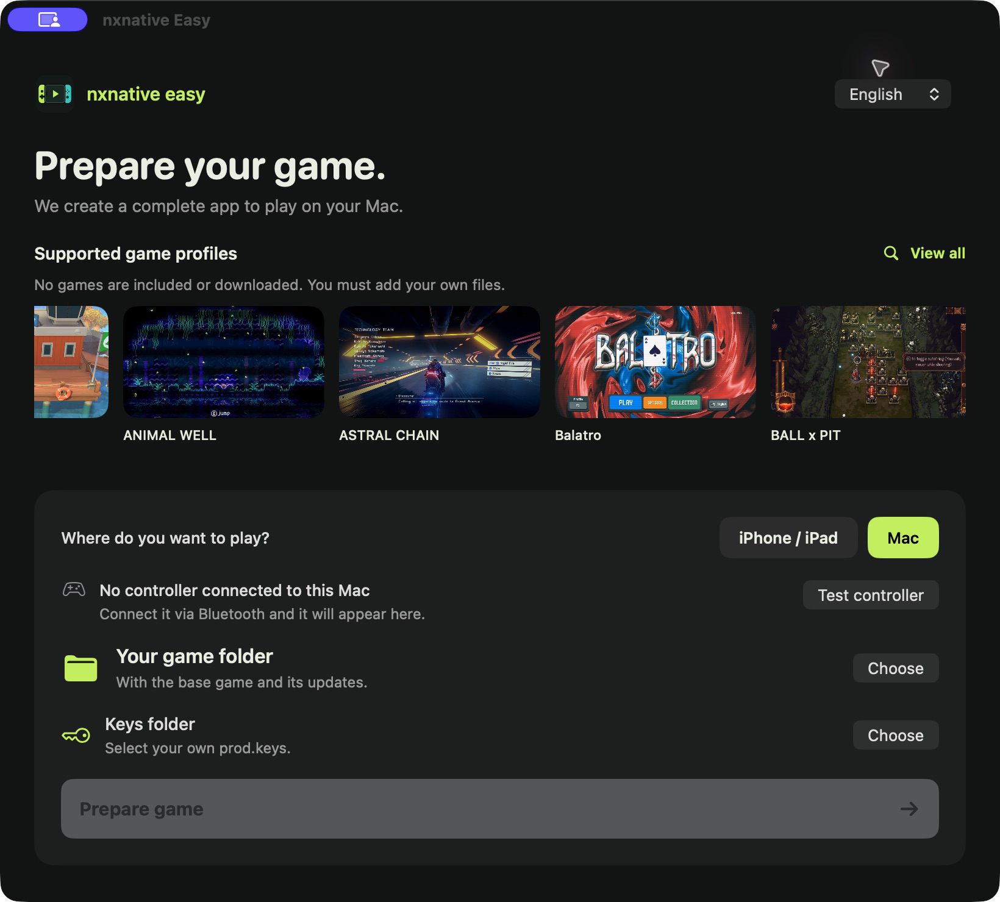
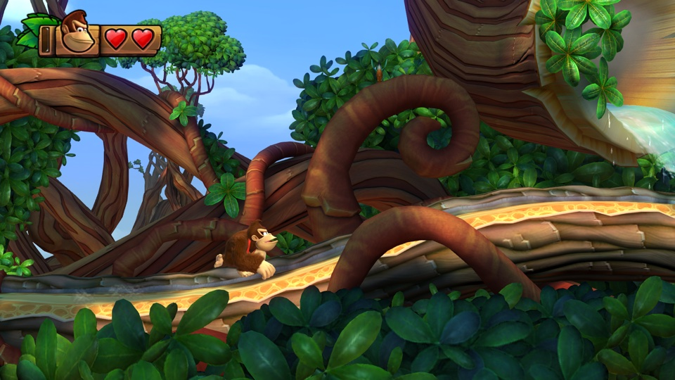
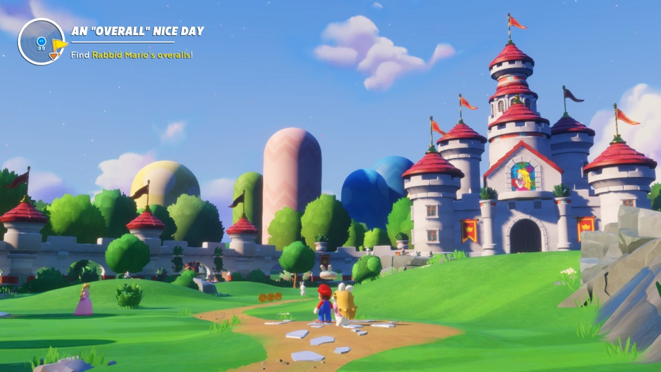
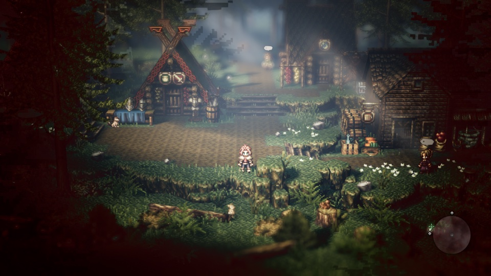
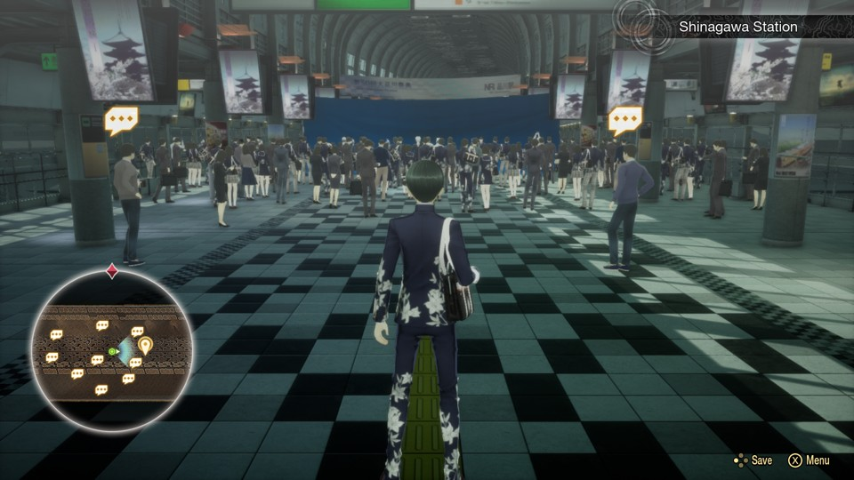
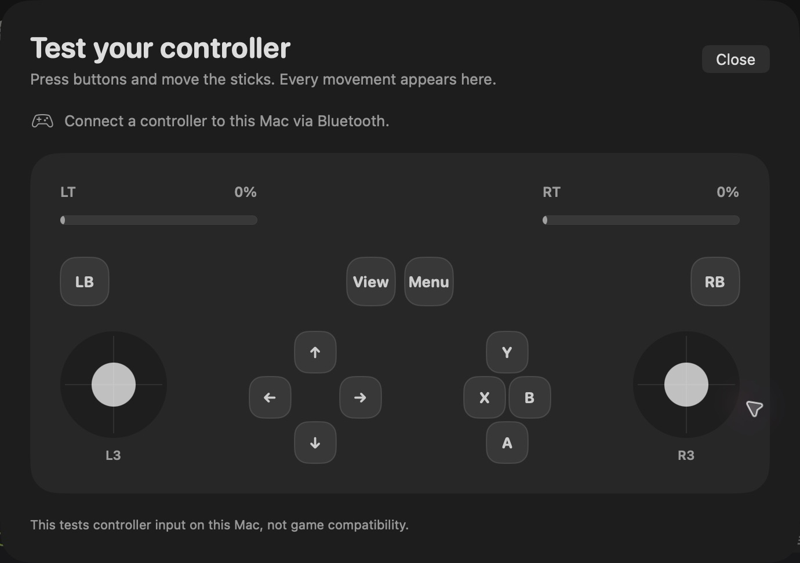

# nxnative Easy

**English** · [Español](README-es.md)

**Run your own supported Nintendo Switch games natively on Mac, iPhone and iPad — with Metal graphics, physical controllers and editable touch controls.**

## Start here

**First:** install full [Xcode](https://apps.apple.com/app/xcode/id497799835) from the Mac App Store and open it once. **Xcode compiles the games too**, so a prebuilt launcher cannot remove this requirement.

**Then:** paste this single command into Terminal:

```bash
/bin/bash -c "$(curl -fsSL https://raw.githubusercontent.com/nalancer08/nxnative-easy/main/install.sh)"
```

It downloads nxnative Easy, installs Homebrew and the missing build tools, **compiles your own Mac interface and opens it**. Follow the four numbered setup stages and any password or confirmation prompts in Terminal. No Apple developer account is used. If you run setup again, it verifies the new app before replacing your installed version and keeps the previous app as a backup.

**Already downloaded this repository?** Double-click **START-HERE.command** in its top-level folder. It performs the same setup; you do not need to find a script under `scripts/`. If macOS blocks that file, use the Terminal command above.

When the app opens:

1. Choose **iPhone / iPad** or **Mac**.
2. Choose your own **game folder** and **keys folder**.
3. Click **Prepare game**.

**After setup:** open **nxnative Easy.app** in your home **Applications** folder. The setup keeps its source checkout separately, so you can delete the downloaded ZIP and folder.

**Mac:** creates one complete game `.app`, with its game data included inside; click **Open game**. No separate RomFS folder to copy. No Sideloadly or iPhone needed. Saves stay in `~/Library/Application Support/nxnative/<title ID>/`.

**iPhone / iPad:** creates an unsigned lightweight IPA; install it with Sideloadly, then copy the game data as shown in the app. [See the iPhone/iPad preparation screen](docs/images/nxnative-ios-v1.4.png).

**Required:** an Apple silicon Mac (M1 or newer), macOS 26+ and Xcode 26+. The command installs the other tools. You must provide your own games and keys. Compilation can take time, especially for the first game. The window shows the current stage, real counters when available, elapsed time and a live log. **Show saved logs** keeps the session output accessible; **Show compiler logs** opens the original tool logs.



## What this version adds

Built on [seedds/nxnative](https://github.com/seedds/nxnative). The original project provides the engine, game profiles and compatibility work. **nxnative Easy** adds:

- **Native Mac app:** game-folder selection, progress, cancellation, and buttons for the IPA, RomFS data and Sideloadly.
- **Editable iPhone touch controls:** position, size and opacity, saved per game and 2D/3D layout.
- **Lightweight IPA export for iPhone/iPad only:** RomFS data live separately; existing outputs and valid caches are preserved.
- **Your own keys:** explicitly select the external folder containing your `prod.keys`. No games or keys are included, downloaded or distributed.
- **Local preparation:** no Apple account or company certificate is used to build the desktop app.

We provide **source code, a preparation interface and build tools**. The output is a local Mac game app, or an unsigned iPhone/iPad IPA that you sign and install yourself with Sideloadly. Games, console keys, Apple signing and universal game compatibility are not provided.

## Engine updates and multiplayer

Our main incorporates the upstream revision recorded in the [integration review](docs/personal-pr-review.md). Future core updates are merged and tested in a separate checkout while preserving our interface and controls. Every accepted game is synchronized across the app, screenshots, notes and both README galleries; CI checks that none are missing. **Update now** installs our tested releases, rather than unreviewed upstream changes.

The current runtime plays **offline**. Nintendo online services, LAN/netplay and Windows are not supported. A Nintendo Switch Online subscription does not enable them here. Local controllers on one Mac are a separate feature. [How the game code, mods and networking work](docs/development.md#game-binaries-mods-and-networking).

## Language

The app starts in **English**. Choose **Español** using the selector at the top; your selection is remembered on this Mac. This changes the interface language, not the game's language. Build diagnostics keep their original language.

## Updating the app

From **version 1.4**, the app checks for new releases at launch and every six hours while open. When one is available, click **Update now**. It downloads the new source and game profiles, builds and verifies the new Mac interface, then restarts it. Progress stays in the window. You can also use **nxnative Easy → Check for updates…**.

The update uses a separate source folder and keeps the previous app as a backup. It does not reset your checkout or modify your game files, keys or saves. Updates are disabled while preparing a game. To apply new engine or profile changes to a previously prepared game, prepare that game again.

**Using version 1.3 or earlier?** Run the setup command above once, or double-click **START-HERE.command**. Future updates then appear inside the app.

## What happens after Prepare game?

The app prepares the tools and builds for your chosen device. **Mac** produces a game app with **Open game** and **Show app** buttons. **iPhone / iPad** produces a lightweight IPA and shows the Sideloadly and Finder steps when ready. Your own files and previous outputs stay in the game folder.

Setup keeps a separate source checkout and preserves local edits. Developers can still use [`scripts/Abrir-interfaz.command`](scripts/Abrir-interfaz.command).

## How the Mac app is built

The launcher uses Xcode's Swift compiler. The desktop app is explicitly **ad-hoc signed**, locally, with no Apple account, certificate or team (`TeamIdentifier` is unset). No company account is used. You enter your personal Apple account separately in Sideloadly when signing the **iPhone IPA**.

The app has an original phone-and-controller icon. Game cards use the existing upstream screenshots in this repository as a support reference; they do not provide or download games.

## Install with Sideloadly and Finder

1. When the IPA is ready, connect your iPhone and click **Send to Sideloadly**. The app opens the prepared IPA there.
2. In Sideloadly, click **Start** using your **personal** Apple account. If needed, use **Show IPA** to find the file manually.
3. On the first installation, click **Show game data** and copy the complete `romfs` folder using **Finder → iPhone → Files → your game**.

For updates, keep the same Apple account and effective bundle ID used in Sideloadly. **Install over the existing app; do not uninstall it**, to retain its saves. Reuse the existing `romfs` only when the game data have not changed. The app installs missing build dependencies after Xcode and Homebrew are available, but **does not sign or install the iPhone game**. Those steps happen in Sideloadly. The app explains them only when the IPA is ready. See the [official Sideloadly FAQ](https://sideloadly.io/faq).

## Updating a prepared game

Add your own update files to the same game folder and prepare it again. The app
recognizes its previous preparation and explains that this is an update; it
cannot inspect what is installed on an iPhone. A new game version still needs
compatible engine/profile support.

- **Mac:** a new complete `.app` is created; the previous app remains available.
  Close the old game and open the new app. The Title ID and bundle identity are
  retained; saves stay outside the app in Application Support.
- **iPhone / iPad:** install the new IPA over the existing app using the same
  Sideloadly account and effective identifier. For a game-content update, replace
  only `romfs` with the newly prepared data via Finder. Keep `save`, `save_device`
  and the installed app; do not delete them.

Optional developer analysis is under **Analysis tools → Analyze with REA**.
It exports original code for an existing native analysis engine; it does not
make unsupported games work automatically. [Analysis flow and prerequisites](docs/game-analysis.md).

## Included game profiles

The home carousel shows the game profiles in your checkout; it does not provide or download games. You must add your own game files. Click **View all** at the top right to browse the complete support list. Search by name, version or Title ID; each result links to its game notes. The catalog reads the local profiles each time you open it. The carousel rotates automatically and pauses while you hover over it.

**Our own checks cover macOS compilation and packaging, not automatic iPhone gameplay verification.** Profiles and gameplay reports come from upstream and may concern Mac or iPhone; read [your game's notes](dm/games/README.md#games). A profile does not guarantee that every game version works on every device.

This base requires iOS/iPadOS 26 or later, an iPhone with A17 Pro or later, or an iPad with M1 or later. Supply your own game files and keys.

<!-- BEGIN GENERATED GAME GALLERY -->
78 profiles. See each game's notes for tested versions and devices.

<table>
<tr>
<td align="center" valign="top" width="33%" data-title-id="01003FC01670C000"><a href="dm/games/01003FC01670C000/README.md"></a><br><a href="dm/games/01003FC01670C000/README.md">13 Sentinels: Aegis Rim</a><br><sub>~5 GB</sub></td>
<td align="center" valign="top" width="33%" data-title-id="01008D7016438000"><a href="dm/games/01008D7016438000/README.md"></a><br><a href="dm/games/01008D7016438000/README.md">13 Sentinels: Aegis Rim (Asia)</a><br><sub>~5 GB</sub></td>
<td align="center" valign="top" width="33%" data-title-id="0100A83022A22000"><a href="dm/games/0100A83022A22000/README.md"></a><br><a href="dm/games/0100A83022A22000/README.md">Absolum</a><br><sub>~2 GB</sub></td>
</tr>
<tr>
<td align="center" valign="top" width="33%" data-title-id="010005501E68C000"><a href="dm/games/010005501E68C000/README.md"></a><br><a href="dm/games/010005501E68C000/README.md">Ace Attorney Investigations Collection</a><br><sub>~7 GB</sub></td>
<td align="center" valign="top" width="33%" data-title-id="0100300012F2A000"><a href="dm/games/0100300012F2A000/README.md"></a><br><a href="dm/games/0100300012F2A000/README.md">Advance Wars 1+2: Re-Boot Camp</a><br><sub>~7.1 GB</sub></td>
<td align="center" valign="top" width="33%" data-title-id="010089B00D09C000"><a href="dm/games/010089B00D09C000/README.md"></a><br><a href="dm/games/010089B00D09C000/README.md">AI: THE SOMNIUM FILES</a><br><sub>~8.3 GB</sub></td>
</tr>
<tr>
<td align="center" valign="top" width="33%" data-title-id="0100713016CCC000"><a href="dm/games/0100713016CCC000/README.md"></a><br><a href="dm/games/0100713016CCC000/README.md">AI: THE SOMNIUM FILES - nirvanA Initiative</a><br><sub>~11.6 GB</sub></td>
<td align="center" valign="top" width="33%" data-title-id="01006F8002326000"><a href="dm/games/01006F8002326000/README.md"></a><br><a href="dm/games/01006F8002326000/README.md">Animal Crossing: New Horizons</a><br><sub>~10.5 GB</sub></td>
<td align="center" valign="top" width="33%" data-title-id="010020D01AD24000"><a href="dm/games/010020D01AD24000/README.md"></a><br><a href="dm/games/010020D01AD24000/README.md">ANIMAL WELL</a><br><sub>~54 MB</sub></td>
</tr>
<tr>
<td align="center" valign="top" width="33%" data-title-id="01007300020FA000"><a href="dm/games/01007300020FA000/README.md"></a><br><a href="dm/games/01007300020FA000/README.md">ASTRAL CHAIN</a><br><sub>~9.7 GB · 60 fps target with 1.0.1</sub></td>
<td align="center" valign="top" width="33%" data-title-id="0100CD801CE5E000"><a href="dm/games/0100CD801CE5E000/README.md"></a><br><a href="dm/games/0100CD801CE5E000/README.md">Balatro</a><br><sub>~82 MB · played by touch</sub></td>
<td align="center" valign="top" width="33%" data-title-id="010086A022444000"><a href="dm/games/010086A022444000/README.md"></a><br><a href="dm/games/010086A022444000/README.md">BALL x PIT</a><br><sub>~1.1 GB</sub></td>
</tr>
<tr>
<td align="center" valign="top" width="33%" data-title-id="010076F0049A2000"><a href="dm/games/010076F0049A2000/README.md"></a><br><a href="dm/games/010076F0049A2000/README.md">Bayonetta</a><br><sub>~8.8 GB</sub></td>
<td align="center" valign="top" width="33%" data-title-id="01007960049A0000"><a href="dm/games/01007960049A0000/README.md"></a><br><a href="dm/games/01007960049A0000/README.md">Bayonetta 2</a><br><sub>~12.5 GB</sub></td>
<td align="center" valign="top" width="33%" data-title-id="01004A4010FEA000"><a href="dm/games/01004A4010FEA000/README.md"></a><br><a href="dm/games/01004A4010FEA000/README.md">Bayonetta 3</a><br><sub>~14.2 GB</sub></td>
</tr>
<tr>
<td align="center" valign="top" width="33%" data-title-id="0100620012D6E000"><a href="dm/games/0100620012D6E000/README.md"></a><br><a href="dm/games/0100620012D6E000/README.md">Big Brain Academy: Brain vs. Brain</a><br><sub>~0.8 GB</sub></td>
<td align="center" valign="top" width="33%" data-title-id="0100F5D01DA3A000"><a href="dm/games/0100F5D01DA3A000/README.md"></a><br><a href="dm/games/0100F5D01DA3A000/README.md">Brain Memory Training Academy</a><br><sub>~0.1 GB</sub></td>
<td align="center" valign="top" width="33%" data-title-id="01009BF0072D4000"><a href="dm/games/01009BF0072D4000/README.md"></a><br><a href="dm/games/01009BF0072D4000/README.md">Captain Toad: Treasure Tracker</a><br><sub>~2 GB</sub></td>
</tr>
<tr>
<td align="center" valign="top" width="33%" data-title-id="0100BF00112C0000"><a href="dm/games/0100BF00112C0000/README.md"></a><br><a href="dm/games/0100BF00112C0000/README.md">Catherine: Full Body</a><br><sub>~14 GB</sub></td>
<td align="center" valign="top" width="33%" data-title-id="01002B30028F6000"><a href="dm/games/01002B30028F6000/README.md"></a><br><a href="dm/games/01002B30028F6000/README.md">Celeste</a><br><sub>~0.9 GB</sub></td>
<td align="center" valign="top" width="33%" data-title-id="0100A5C00D162000"><a href="dm/games/0100A5C00D162000/README.md"></a><br><a href="dm/games/0100A5C00D162000/README.md">Cuphead</a><br><sub>~5 GB</sub></td>
</tr>
<tr>
<td align="center" valign="top" width="33%" data-title-id="01004AB00A260000"><a href="dm/games/01004AB00A260000/README.md"></a><br><a href="dm/games/01004AB00A260000/README.md">DARK SOULS: REMASTERED</a><br><sub>~4 GB · 60 fps with 1.0.3</sub></td>
<td align="center" valign="top" width="33%" data-title-id="010014E00DB56000"><a href="dm/games/010014E00DB56000/README.md"></a><br><a href="dm/games/010014E00DB56000/README.md">Digimon Story Cyber Sleuth: Complete Edition</a><br><sub>~5 GB</sub></td>
<td align="center" valign="top" width="33%" data-title-id="01009D901BC56000"><a href="dm/games/01009D901BC56000/README.md"></a><br><a href="dm/games/01009D901BC56000/README.md">Donkey Kong Country Returns HD</a><br><sub>~11.6 GB</sub></td>
</tr>
<tr>
<td align="center" valign="top" width="33%" data-title-id="0100C1F0051B6000"><a href="dm/games/0100C1F0051B6000/README.md"></a><br><a href="dm/games/0100C1F0051B6000/README.md">Donkey Kong Country: Tropical Freeze</a><br><sub>~7.3 GB</sub></td>
<td align="center" valign="top" width="33%" data-title-id="0100A9D01C446000"><a href="dm/games/0100A9D01C446000/README.md"></a><br><a href="dm/games/0100A9D01C446000/README.md">DRAGON QUEST VII Reimagined</a><br><sub>~5.9 GB</sub></td>
<td align="center" valign="top" width="33%" data-title-id="01006C300E9F0000"><a href="dm/games/01006C300E9F0000/README.md"></a><br><a href="dm/games/01006C300E9F0000/README.md">DRAGON QUEST XI S: Echoes of an Elusive Age – Definitive Edition</a><br><sub>~15 GB · 60 fps with 1.0.4</sub></td>
</tr>
<tr>
<td align="center" valign="top" width="33%" data-title-id="0100606026F12000"><a href="dm/games/0100606026F12000/README.md"></a><br><a href="dm/games/0100606026F12000/README.md">FINAL FANTASY RESONANCE</a><br><sub>~10 GB · 60 fps with 1.0.1</sub></td>
<td align="center" valign="top" width="33%" data-title-id="010038B015560000"><a href="dm/games/010038B015560000/README.md"></a><br><a href="dm/games/010038B015560000/README.md">FINAL FANTASY TACTICS - The Ivalice Chronicles</a><br><sub>~11 GB</sub></td>
<td align="center" valign="top" width="33%" data-title-id="0100A6301214E000"><a href="dm/games/0100A6301214E000/README.md"></a><br><a href="dm/games/0100A6301214E000/README.md">Fire Emblem Engage</a><br><sub>~15 GB · 60 fps with 2.0.0</sub></td>
</tr>
<tr>
<td align="center" valign="top" width="33%" data-title-id="010055D009F78000"><a href="dm/games/010055D009F78000/README.md"></a><br><a href="dm/games/010055D009F78000/README.md">Fire Emblem: Three Houses</a><br><sub>~13 GB · 60 fps with 1.2.0</sub></td>
<td align="center" valign="top" width="33%" data-title-id="010029B018432000"><a href="dm/games/010029B018432000/README.md"></a><br><a href="dm/games/010029B018432000/README.md">Ghost Trick: Phantom Detective</a><br><sub>~3 GB</sub></td>
<td align="center" valign="top" width="33%" data-title-id="0100535012974000"><a href="dm/games/0100535012974000/README.md"></a><br><a href="dm/games/0100535012974000/README.md">Hades</a><br><sub>~4 GB</sub></td>
</tr>
<tr>
<td align="center" valign="top" width="33%" data-title-id="0100A00019DE0000"><a href="dm/games/0100A00019DE0000/README.md"></a><br><a href="dm/games/0100A00019DE0000/README.md">Hades II</a><br><sub>~4 GB</sub></td>
<td align="center" valign="top" width="33%" data-title-id="010013C00E930000"><a href="dm/games/010013C00E930000/README.md"></a><br><a href="dm/games/010013C00E930000/README.md">Hollow Knight: Silksong</a><br><sub>~6.4 GB</sub></td>
<td align="center" valign="top" width="33%" data-title-id="01002B00111A2000"><a href="dm/games/01002B00111A2000/README.md"></a><br><a href="dm/games/01002B00111A2000/README.md">Hyrule Warriors: Age of Calamity</a><br><sub>~15 GB · 60 fps with 1.3.0</sub></td>
</tr>
<tr>
<td align="center" valign="top" width="33%" data-title-id="01004D300C5AE000"><a href="dm/games/01004D300C5AE000/README.md"></a><br><a href="dm/games/01004D300C5AE000/README.md">Kirby and the Forgotten Land</a><br><sub>~6.4 GB</sub></td>
<td align="center" valign="top" width="33%" data-title-id="0100DCA0064A6000"><a href="dm/games/0100DCA0064A6000/README.md"></a><br><a href="dm/games/0100DCA0064A6000/README.md">Luigi&#x27;s Mansion 3</a><br><sub>~7.5 GB · 60 fps with 1.4.0</sub></td>
<td align="center" valign="top" width="33%" data-title-id="0100152000022000"><a href="dm/games/0100152000022000/README.md"></a><br><a href="dm/games/0100152000022000/README.md">Mario Kart 8 Deluxe</a><br><sub>~11.9 GB · no Mii heads</sub></td>
</tr>
<tr>
<td align="center" valign="top" width="33%" data-title-id="0100317013770000"><a href="dm/games/0100317013770000/README.md"></a><br><a href="dm/games/0100317013770000/README.md">Mario + Rabbids® Sparks of Hope</a><br><sub>~9.8 GB</sub></td>
<td align="center" valign="top" width="33%" data-title-id="0100B99019412000"><a href="dm/games/0100B99019412000/README.md"></a><br><a href="dm/games/0100B99019412000/README.md">Mario vs. Donkey Kong</a><br><sub>~1.6 GB</sub></td>
<td align="center" valign="top" width="33%" data-title-id="010093801237C000"><a href="dm/games/010093801237C000/README.md"></a><br><a href="dm/games/010093801237C000/README.md">Metroid Dread</a><br><sub>~5 GB</sub></td>
</tr>
<tr>
<td align="center" valign="top" width="33%" data-title-id="0100B04011742000"><a href="dm/games/0100B04011742000/README.md"></a><br><a href="dm/games/0100B04011742000/README.md">Monster Hunter Rise</a><br><sub>~22 GB · 60 fps with 16.0.2</sub></td>
<td align="center" valign="top" width="33%" data-title-id="010051701FB46000"><a href="dm/games/010051701FB46000/README.md"></a><br><a href="dm/games/010051701FB46000/README.md">Monster Train 2</a><br><sub>~1.6 GB · 60 fps with 1.1.1</sub></td>
<td align="center" valign="top" width="33%" data-title-id="010056B015FE8000"><a href="dm/games/010056B015FE8000/README.md"></a><br><a href="dm/games/010056B015FE8000/README.md">NieR:Automata The End of YoRHa Edition</a><br><sub>~10.9 GB · 60 fps with 1.0.3</sub></td>
</tr>
<tr>
<td align="center" valign="top" width="33%" data-title-id="010057D006492000"><a href="dm/games/010057D006492000/README.md"></a><br><a href="dm/games/010057D006492000/README.md">OCTOPATH TRAVELER</a><br><sub>~3.6 GB</sub></td>
<td align="center" valign="top" width="33%" data-title-id="01005270232F2000"><a href="dm/games/01005270232F2000/README.md"></a><br><a href="dm/games/01005270232F2000/README.md">OCTOPATH TRAVELER 0</a><br><sub>~4 GB · 60 fps with 1.0.5</sub></td>
<td align="center" valign="top" width="33%" data-title-id="0100A3501946E000"><a href="dm/games/0100A3501946E000/README.md"></a><br><a href="dm/games/0100A3501946E000/README.md">OCTOPATH TRAVELER II</a><br><sub>~5.9 GB · 60 fps with 1.1.1</sub></td>
</tr>
<tr>
<td align="center" valign="top" width="33%" data-title-id="0100ECD018EBE000"><a href="dm/games/0100ECD018EBE000/README.md"></a><br><a href="dm/games/0100ECD018EBE000/README.md">Paper Mario: The Thousand-Year Door</a><br><sub>~5 GB · 60 fps with 1.0.1</sub></td>
<td align="center" valign="top" width="33%" data-title-id="0100E44016C22000"><a href="dm/games/0100E44016C22000/README.md"></a><br><a href="dm/games/0100E44016C22000/README.md">Patrick&#x27;s Parabox</a><br><sub>~0.2 GB</sub></td>
<td align="center" valign="top" width="33%" data-title-id="01005CA01580E000"><a href="dm/games/01005CA01580E000/README.md"></a><br><a href="dm/games/01005CA01580E000/README.md">Persona 5 Royal</a><br><sub>~14.9 GB</sub></td>
</tr>
<tr>
<td align="center" valign="top" width="33%" data-title-id="0100B7C00933A000"><a href="dm/games/0100B7C00933A000/README.md"></a><br><a href="dm/games/0100B7C00933A000/README.md">Pikmin 4</a><br><sub>~10.8 GB</sub></td>
<td align="center" valign="top" width="33%" data-title-id="0100000011D90000"><a href="dm/games/0100000011D90000/README.md"></a><br><a href="dm/games/0100000011D90000/README.md">Pokémon Brilliant Diamond</a><br><sub>~4.6 GB · 60 fps with 1.3.0</sub></td>
<td align="center" valign="top" width="33%" data-title-id="0100F43008C44000"><a href="dm/games/0100F43008C44000/README.md"></a><br><a href="dm/games/0100F43008C44000/README.md">Pokémon Legends: Z-A</a><br><sub>~6 GB</sub></td>
</tr>
<tr>
<td align="center" valign="top" width="33%" data-title-id="01008DB008C2C000"><a href="dm/games/01008DB008C2C000/README.md"></a><br><a href="dm/games/01008DB008C2C000/README.md">Pokémon Shield</a><br><sub>~12.4 GB</sub></td>
<td align="center" valign="top" width="33%" data-title-id="0100ABF008968000"><a href="dm/games/0100ABF008968000/README.md"></a><br><a href="dm/games/0100ABF008968000/README.md">Pokémon Sword</a><br><sub>~12.4 GB</sub></td>
<td align="center" valign="top" width="33%" data-title-id="01007BB017812000"><a href="dm/games/01007BB017812000/README.md"></a><br><a href="dm/games/01007BB017812000/README.md">Portal</a><br><sub>~2.6 GB</sub></td>
</tr>
<tr>
<td align="center" valign="top" width="33%" data-title-id="010020400E1C2000"><a href="dm/games/010020400E1C2000/README.md"></a><br><a href="dm/games/010020400E1C2000/README.md">Raging Loop</a><br><sub>~0.9 GB</sub></td>
<td align="center" valign="top" width="33%" data-title-id="0100D9F01D474000"><a href="dm/games/0100D9F01D474000/README.md"></a><br><a href="dm/games/0100D9F01D474000/README.md">Rhythm Heaven Groove</a><br><sub>~3 GB</sub></td>
<td align="center" valign="top" width="33%" data-title-id="0100C2A01A730000"><a href="dm/games/0100C2A01A730000/README.md"></a><br><a href="dm/games/0100C2A01A730000/README.md">ROMANCE OF THE THREE KINGDOMS 8 REMAKE</a><br><sub>~16.8 GB · controller only</sub></td>
</tr>
<tr>
<td align="center" valign="top" width="33%" data-title-id="01008C0016544000"><a href="dm/games/01008C0016544000/README.md"></a><br><a href="dm/games/01008C0016544000/README.md">Sea of Stars</a><br><sub>~5.1 GB</sub></td>
<td align="center" valign="top" width="33%" data-title-id="010069C01AB82000"><a href="dm/games/010069C01AB82000/README.md"></a><br><a href="dm/games/010069C01AB82000/README.md">SHIN MEGAMI TENSEI V: Vengeance</a><br><sub>~14.6 GB · 60 fps with 1.0.3</sub></td>
<td align="center" valign="top" width="33%" data-title-id="0100E65002BB8000"><a href="dm/games/0100E65002BB8000/README.md"></a><br><a href="dm/games/0100E65002BB8000/README.md">Stardew Valley</a><br><sub>~0.6 GB</sub></td>
</tr>
<tr>
<td align="center" valign="top" width="33%" data-title-id="01008BC024FDE000"><a href="dm/games/01008BC024FDE000/README.md"></a><br><a href="dm/games/01008BC024FDE000/README.md">STEINS;GATE RE:BOOT</a><br><sub>~6 GB</sub></td>
<td align="center" valign="top" width="33%" data-title-id="010028600EBDA000"><a href="dm/games/010028600EBDA000/README.md"></a><br><a href="dm/games/010028600EBDA000/README.md">Super Mario 3D World + Bowser&#x27;s Fury</a><br><sub>~3 GB</sub></td>
<td align="center" valign="top" width="33%" data-title-id="010015100B514000"><a href="dm/games/010015100B514000/README.md"></a><br><a href="dm/games/010015100B514000/README.md">Super Mario Bros. Wonder</a><br><sub>~4 GB</sub></td>
</tr>
<tr>
<td align="center" valign="top" width="33%" data-title-id="010099C022B96000"><a href="dm/games/010099C022B96000/README.md"></a><br><a href="dm/games/010099C022B96000/README.md">Super Mario Galaxy</a><br><sub>~3 GB</sub></td>
<td align="center" valign="top" width="33%" data-title-id="0100FD8022DAA000"><a href="dm/games/0100FD8022DAA000/README.md"></a><br><a href="dm/games/0100FD8022DAA000/README.md">Super Mario Galaxy 2</a><br><sub>~3 GB</sub></td>
<td align="center" valign="top" width="33%" data-title-id="0100000000010000"><a href="dm/games/0100000000010000/README.md"></a><br><a href="dm/games/0100000000010000/README.md">Super Mario Odyssey</a><br><sub>~6 GB</sub></td>
</tr>
<tr>
<td align="center" valign="top" width="33%" data-title-id="01006A800016E000"><a href="dm/games/01006A800016E000/README.md"></a><br><a href="dm/games/01006A800016E000/README.md">Super Smash Bros. Ultimate</a><br><sub>~17.5 GB · offline</sub></td>
<td align="center" valign="top" width="33%" data-title-id="0100346017304000"><a href="dm/games/0100346017304000/README.md"></a><br><a href="dm/games/0100346017304000/README.md">Taiko Risshiden V DX</a><br><sub>~3.3 GB · Japanese · played by touch</sub></td>
<td align="center" valign="top" width="33%" data-title-id="010036E00FB20000"><a href="dm/games/010036E00FB20000/README.md"></a><br><a href="dm/games/010036E00FB20000/README.md">The Great Ace Attorney Chronicles</a><br><sub>~4 GB</sub></td>
</tr>
<tr>
<td align="center" valign="top" width="33%" data-title-id="01007EF00011E000"><a href="dm/games/01007EF00011E000/README.md"></a><br><a href="dm/games/01007EF00011E000/README.md">The Legend of Zelda: Breath of the Wild</a><br><sub>~16 GB · 60 fps with 1.9.0</sub></td>
<td align="center" valign="top" width="33%" data-title-id="01008CF01BAAC000"><a href="dm/games/01008CF01BAAC000/README.md"></a><br><a href="dm/games/01008CF01BAAC000/README.md">The Legend of Zelda: Echoes of Wisdom</a><br><sub>~7.8 GB</sub></td>
<td align="center" valign="top" width="33%" data-title-id="01006BB00C6F0000"><a href="dm/games/01006BB00C6F0000/README.md"></a><br><a href="dm/games/01006BB00C6F0000/README.md">The Legend of Zelda: Link&#x27;s Awakening</a><br><sub>~6 GB</sub></td>
</tr>
<tr>
<td align="center" valign="top" width="33%" data-title-id="0100F2C0115B6000"><a href="dm/games/0100F2C0115B6000/README.md"></a><br><a href="dm/games/0100F2C0115B6000/README.md">The Legend of Zelda: Tears of the Kingdom</a><br><sub>~17 GB · 60 fps with 1.4.3</sub></td>
<td align="center" valign="top" width="33%" data-title-id="010069401ADB8000"><a href="dm/games/010069401ADB8000/README.md"></a><br><a href="dm/games/010069401ADB8000/README.md">Unicorn Overlord</a><br><sub>~4 GB</sub></td>
<td align="center" valign="top" width="33%" data-title-id="010074F013262000"><a href="dm/games/010074F013262000/README.md"></a><br><a href="dm/games/010074F013262000/README.md">Xenoblade Chronicles 3</a><br><sub>~19.2 GB</sub></td>
</tr>
</table>
<!-- END GENERATED GAME GALLERY -->

## Xbox, PS5 and PS4 controllers

The game apps use Apple's GameController framework on **Mac, iPhone and iPad**:

- **Xbox:** Bluetooth-capable Xbox Wireless Controller (model 1708), Series X/S and Elite Series 2.
- **PS5:** DualSense and DualSense Edge.
- **PS4:** DualShock 4.

The preparation app automatically shows connected controller names and **Ready on this Mac** when Apple exposes a compatible gamepad profile. It updates when you connect or disconnect a controller. The Mac controller panel is hidden when you choose iPhone/iPad. Pair a controller directly with the device where you will play.

In **Mac** mode, click **Test controller** to see live input: buttons and D-pad light up, both sticks move, and trigger bars show pressure. **Input received!** appears only after input is detected. If several controllers are connected, choose which one to test. The tester reads input only while its window is visible and does not take input handlers away from games.



Pair your controller in the device's **Bluetooth settings**, then open the prepared game. No extra driver or launcher setting is needed. Sticks, D-pad, face buttons, shoulders, triggers, stick clicks and menu buttons are mapped automatically. On iPhone/iPad, touch controls hide while a physical controller is connected.

Face buttons follow **Nintendo positions**, rather than the letters printed on an Xbox controller: Switch A = Xbox B / PlayStation Circle; Switch B = Xbox A / Cross; Switch X = Xbox Y / Triangle; Switch Y = Xbox X / Square.

Standard gamepad input is supported; DualSense adaptive triggers, controller motion and touchpad gestures are not mapped. Rumble depends on the features exposed by the controller and OS. Mac supports separate local players when the game allows it; iPhone/iPad merge controllers into player 1.

See Apple's [Xbox pairing guide](https://support.apple.com/en-us/111101) and [PlayStation pairing guide](https://support.apple.com/en-us/111100). This support was checked in the input code and automated tests; these specific physical models have not been tested in this checkout.

## Make the controls your own

Inside the game, tap **Edit controls**. Move buttons, adjust their size and opacity, then tap **Save**. **Cancel** discards edits; **Reset control / Reset all** restores defaults. Each game has **four named profiles**, each with separate 2D and 3D layouts. Use the profile menu to switch or rename one (for example iPhone, iPad or Large), and **Save as…** to copy both layouts into another slot. Switching warns before discarding unsaved edits; replacing a profile asks first. Your previous layout is preserved in Profile 1. Profiles are stored locally on each device. The game continues running while you edit. The desktop language selector does not translate this in-game editor.

## Cloud-save API prototype

A separate [portable API prototype](dm/cloud/README.md) supports private snapshot versions, upload conflicts and expiring/revocable sharing. **Native cloud login, upload and restore are not connected yet**; no server or identity-provider account has been deployed. Game saves and control profiles continue to stay on your device. This is unrelated to online multiplayer.

<details>
<summary>Guides, commands and technical details</summary>

- [Detailed command and installation guide, in Spanish](README-comandos.md).
- [Automation and troubleshooting](docs/personal-ios.md).
- [Upstream PR applicability review](docs/personal-pr-review.md).
- [Previous README and full credits](README-original.md).

</details>

Based on [seedds/nxnative](https://github.com/seedds/nxnative), with our touch editor and preparation workflow. The [MIT license](LICENSE), [original acknowledgements](README-original.md#acknowledgements) and third-party licenses are retained. Personal additions are authored by **nalancer08**; upstream commits retain their original authors.
