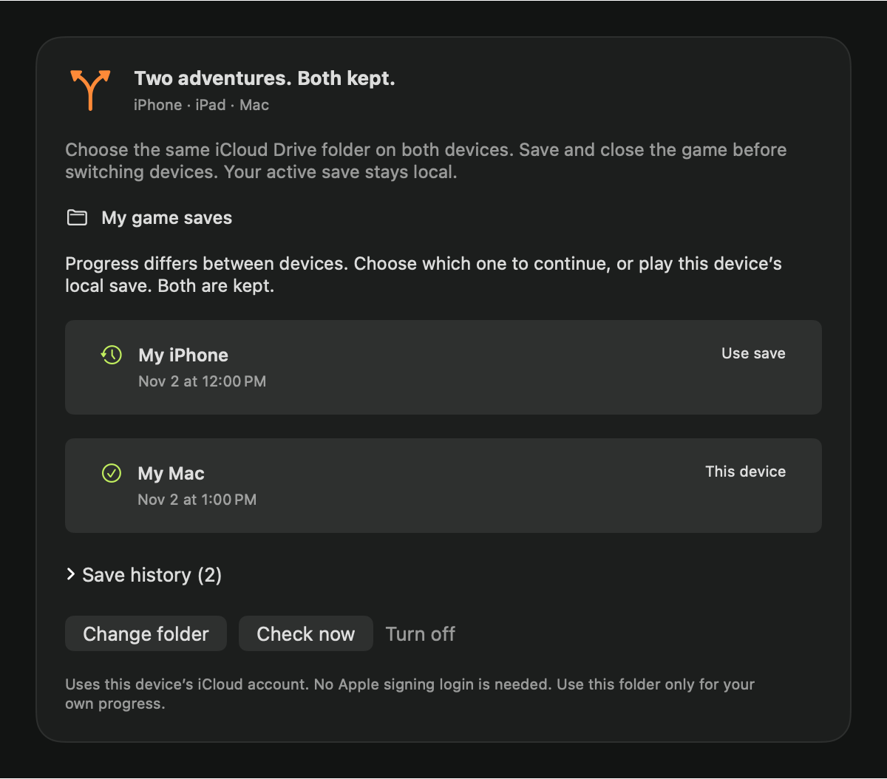
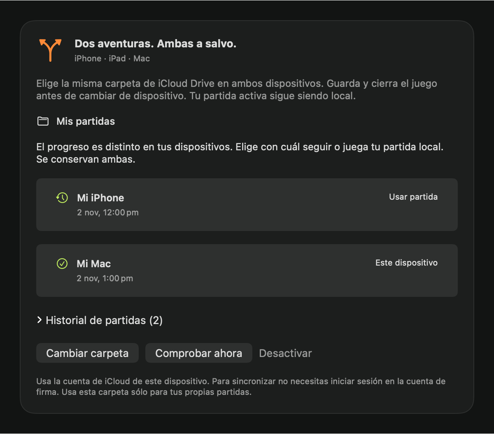
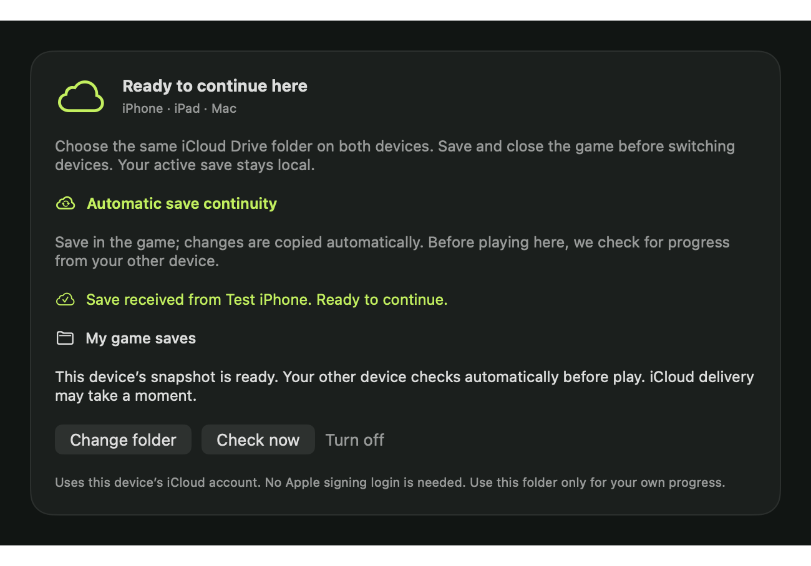
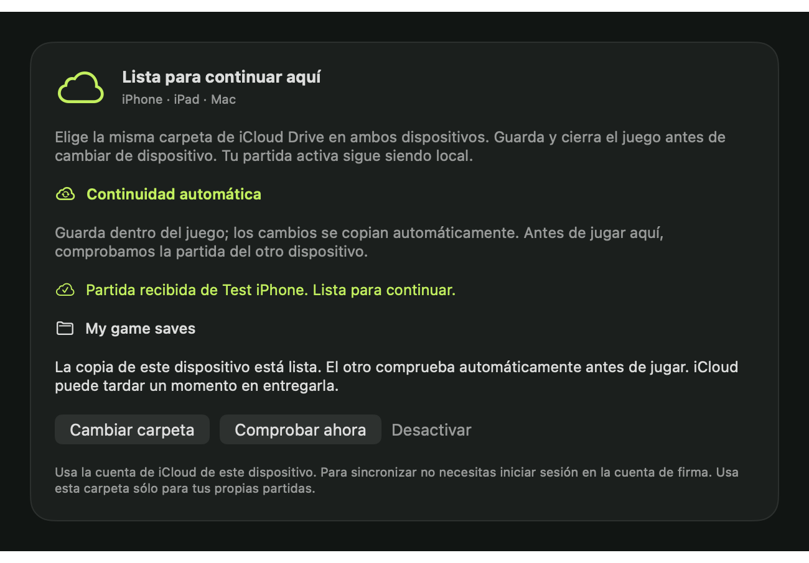

# Continue your game between iPhone, iPad and Mac

Open **Library → Connect iCloud** and choose a folder in iCloud Drive. Easy uses
this Mac's system iCloud session; the account used to sign apps is independent.
Received saves bring their titles into your library, even without local game
files. Open a cover to see destinations, received revisions and manual backups.
**Add to play** starts guided preparation for Mac or iPhone/iPad and checks that
you select files for the same title. No game is downloaded from a save.

[Manual transfers](save-transfer.md) and [game maintenance](game-maintenance.md)
remain available inside the game's detail. There is no separate Saves or Devices
workspace destination.
Save continuity is optional. Each device keeps its own active local save; only
checked snapshots go into a folder you choose in iCloud Drive. No game files,
RomFS, touch-control profiles, signing credentials or keys are uploaded.

Implementation and native synthetic tests are present in this revision. A real
iPhone → iCloud Drive → Mac → iPhone round trip has **not yet been validated**
with the owner's installations. The unsigned iOS compile fixture is not a
playable game or evidence of physical-device synchronization.

## Set it up once / Configuración inicial

1. In Easy, prepare **both** the Mac and iPhone/iPad versions of your game with
   this update. Use the same game version and DLC/content on both. Install over
   the existing iOS app with the same signing account, team and app identity.
   **Do not uninstall your game.** Updating Easy alone cannot change an already
   installed game's runtime. Keep a manual export before the first trial.
2. Easy prepares **iCloud Drive → nxnative Easy → Saves** automatically when
   iCloud Drive is available on this Mac. It preserves an existing custom folder
   choice and respects turning sync off. Advanced folder controls live in
   Settings. New Mac apps receive Easy's folder when you click **Play**. If a Mac
   game already chose another folder, it asks you to review instead of silently
   replacing it. On iPhone/iPad, open each rebuilt game, press **Enable save sync**
   and grant access to **iCloud Drive → nxnative Easy → Saves** once in the system
   picker. Folder permission belongs to each app; signing credentials cannot
   grant it. If you already use a custom folder, keep that same folder everywhere.
3. Save using the game's own save function. Save commits queue snapshots in the
   background. On Mac, the launcher also checks after the game exits; on iOS,
   entering the background requests another snapshot and a finite background
   execution lease, ended promptly when the coalesced workers finish or when
   iOS expires it. iOS may suspend/terminate
   background work; locally queued snapshots are retried on the next launch.
4. Close the game before switching devices. Open its launcher on the other
   device and let the save check finish before pressing **Play**. The active
   pre-game panel retries pending downloads automatically and checks again when
   you return to it. **Play** always checks once more. **Check now** is optional.
   A snapshot being present in the chosen folder is not proof
   that iCloud has already delivered it to another device.

En español: prepara ambas versiones una vez, conserva la identidad de tu app,
elige la misma carpeta de **iCloud Drive** dentro de cada juego y guarda/cierra
antes de cambiar de dispositivo. Espera la comprobación de partidas antes de
jugar en el otro. Si hay conflicto, elige con cuál seguir: se conservan las dos.

## Automatic, with one deliberate exception

There is no upload or download button in the normal playing flow. A successful
in-game save commit queues a content-checked snapshot; an unchanged committed
save does not create another revision. Before starting on another device, a
single compatible continuation is restored automatically and the panel confirms
**Save received from [device]. Ready to continue.** It only shows that notice
after the native restore succeeds, never from a timestamp or a file listing.

While the pre-game panel is active, incomplete iCloud delivery is checked every
3 seconds and recoverable provider failures every 15 seconds. Leaving the app
cancels the loop; returning checks again. Healthy results stop polling; pressing
**Play** still performs a fresh check. A child delivered before its parent stays
in the waiting state until that parent arrives. Revoked folder access needs
reselection; blocked recovery and conflicts do not trigger automatic choices.
Once play starts, no retry may import into the running game's save trees.
If a manual check or the final Play check discovers pending delivery after an
earlier healthy result, the panel starts its automatic retry loop again.

Two independent branches are the exception: dates cannot tell which adventure
is further ahead, so the game asks which one to continue and retains both.
Offline play remains available where local recovery permits it. We cannot know
whether an offline device has unpublished progress; a currently healthy folder
is not proof of global freshness. iCloud scheduling and iOS suspension can delay
delivery. The OS grants only limited background execution, as described by
[Apple's background execution guide](https://developer.apple.com/documentation/uikit/extending-your-app-s-background-execution-time).

The game detail in Easy explains this setup and can review/export copies. The actual automatic receive/restore belongs to each newly prepared
game, not the Easy desktop process. Grant the common folder once in each iOS game/device; enabling it in Easy does
not alter old installed apps. Rebuilt Mac apps can use the folder selected in Easy.

The device's iCloud account supplies storage access. The Apple account used to
sign an IPA in Easy is separate; no signing login or paid developer membership
is requested by this folder-based feature. On iOS the system folder picker and
security-scoped bookmark provide access. After a signing-identity change, stale
bookmark or permission revocation, choose the folder again. Do not grant access
to another person's folder: this runtime has one local player per game.

## If progress differs

The launcher shows both branches with their source device and date. Dates help
you recognize progress; they never decide which save wins. Press **Use save**,
confirm, and then play. The chosen snapshot becomes a revision with both branches
as parents. Neither branch is deleted. **Save history** lets you choose an older
compatible revision later, also retaining your current progress first.

You may instead choose **Play local save**. That continues this device's local
progress without replacing the other branch. Offline play can create a conflict;
that is expected and is resolved the same way when both revisions arrive.

An initial setup with existing, different saves on both devices is a conflict
too. A delayed child whose parent has not downloaded is not permission to guess
or restore half a history. Different game versions/content cannot be restored
automatically; prepare matching content before choosing a revision.

Turning sync off leaves the active save usable and keeps local/cloud history.
It does not delete cloud data. Missing iCloud, quota/space failure, a damaged
snapshot or denied access leaves local progress in place. Free space/restore
access and use **Check now**. Local play remains available unless an unfinished
restore must recover first or another running copy holds this game's save lock.

## What is retained

The selected folder contains:

```text
nxnative-saves-v1/<TITLE ID>/<SHA-256>.nxsave
```

Every revision is one immutable file with bounded metadata and a checked archive
containing both committed `save` and `save_device` trees, including guest-name
extended attributes. It records title, single-player namespace, exact build/content
identity, informational game-app version, source device, informational date and parent revision IDs. No mutable
"latest save" exists for two devices to overwrite. File coordination is local
provider cooperation, not a distributed lock or proof of cloud delivery.

Next to each device's local `save`, `save.nxe-cloud/` retains:

- `revisions/`: verified revisions, including snapshots queued while offline.
- `backups/`: a verified complete pre-restore snapshot.
- `retained-*`: displaced directories kept during successful/interrupted restores.
- `state.json`: the revision corresponding to this device's local progress.
- `restore.json`: only while a recoverable two-folder restore is unfinished.
- `game.lock`: the lease that prevents two local game instances using one save.

A durable journal is recorded before either active directory changes. Recovery
rebuilds the complete target from its local verified snapshot, retains displaced
trees, restores both directories, verifies them and only then clears the journal.
If recovery cannot finish, **Play is blocked**; the game cannot mount a mixed pair.
This applies even with cloud sync disabled or the settings window hidden.

History is not automatically pruned. It consumes space; do not delete it as a
cache, and never remove an unfinished journal to bypass recovery. Manual exports
from Devices remain independent and available. They do not include this history.

## Compatibility and implementation

Both packers generate `dm/save-compat.json`: display version, original NSO build
IDs and SHA-256 hashes of logical RomFS/DLC contents. Mac/iOS shader libraries
and rewritten binaries are deliberately excluded because they differ by platform.
Folder and image packaging of the same content have the same logical identity.
This adds a content scan while packing, not recompilation for every save.
Post-build modifications/external data must still match the packed game content;
do not use sync to force saves across versions or mods. Legacy upstream
`save.dmsync` files are never imported by guessing compatibility.

The native engine is `dm/host/cloud_saves.m`. Archive primitives are adapted from
seedds/nxnative at `4a2a81a64f02` (MIT); upstream date-based arbitration and restore
code are **not** enabled. `hle_fs.c` clones both committed trees while holding
the filesystem's commit locks. Network/provider operations run on a separate
queue. A running game never imports a remote save into its mounted work trees. Payload
buffers are released per revision, with ARC exception cleanup enabled in both
production builds so recoverable I/O failures do not retain large buffers. See
[Clang’s ARC exception contract](https://clang.llvm.org/docs/AutomaticReferenceCounting.html#exceptions).
The shared SwiftUI panel is `dm/ios/Sources/CloudSavePanel.swift`.

Apple's [directory access documentation](https://developer.apple.com/documentation/uikit/providing-access-to-directories)
describes the folder picker, security-scoped access and coordinated operations.

## Validation and next physical check

Native tests use fake saves and an ordinary temporary shared folder, not iCloud:

```sh
python3 -m unittest discover -s dm/host/tests -p test_cloud_saves.py -v
python3 -m unittest dm.ios.tests.test_cloud_automatic -v
```

They exercise bidirectional continuity, initial different saves, divergent offline
play with clock skew, explicit resolution/history, corruption/truncation, missing
parents, unavailable storage, version mismatch, guest-name metadata, symlinks,
and process death at each two-folder restore journal boundary. Native Mac host
and unsigned production iOS compile/link checks complement these tests.

The remaining physical check uses a **test save** and freshly rebuilt versions:
export a backup; choose the same iCloud folder on Mac/iPhone; save and close on
iPhone, continue on Mac, save and close, continue on iPhone. Then play both
offline and verify both branches/explicit choice/history after reconnection.
Also check iOS suspension, revoked folder access and reselection after re-signing.
No agent test signs or installs on the owner's devices or opens real saves.

## Native UI previews and local validation — 2026-11-02

The conflict panel below renders the actual shared SwiftUI component with fake
device names, dates and revisions. It does not access iCloud or the owner's saves.

 

Local validation: 22 native continuity/failure tests passed; 44 Mac packer and
launcher tests passed; 18 save-cache, launcher-storage/layout and documentation
checks passed; the full native host suite passed, including the two-root clone
check that excludes uncommitted writes. The desktop app compiled and its bundle
signature verified. Both production Mac and unsigned iOS targets link the strong
commit/pair-clone hooks; the iOS app contains the exact generated compatibility
manifest. New native files have zero LLVM 23.1.4 findings; Python lint has no new
findings over the pinned baseline. Read-only regression discovery found no
registered Mac gameplay build, so no real-game smoke run was claimed or forced.
Actual iCloud propagation, background suspension and the owner's physical
iPhone/Mac round trip remain to be checked with test saves.

The checkpoint regression also pauses a commit after it claims a worker but
before scheduling it. The old ordering signalled flush completion too early;
entering the dispatch group before publishing that claim keeps the background
lease until the actual snapshot finishes. The failing ordering was reproduced
with synthetic data before the fix, and the regression now passes.

## Automatic continuation validation — 2026-11-03

The current shared game panel confirms an actual native restore, rather than
claiming progress is newer from its date. These renders use a fake backend and
synthetic device names, not the owner's iCloud or saves.

 

All 22 native continuity tests pass, including child-before-parent waiting,
restore after delayed delivery and a receipt emitted only for an actual restore.
The real Swift model also passes a fake-backend fixture for automatic pending
delivery/provider retry, stopping after a healthy result, conflict/permission
guards, cancellation on inactivity, late conflict at Play and no checks/restores
once play starts. Both embedded launchers observe their AppKit/UIKit application
lifecycle directly; they do not require a SwiftUI Scene.
An actual embedded AppKit panel fixture also reproduces a late waiting state
after a healthy check and verifies that automatic checking restarts. The old
task key omitted this transition; the fixture failed before adding retry state
to that key, then passed. Foreground return and stopping after health are covered.

The unsigned production iOS fixture and Mac launcher/storage fixture compile and
link this same component. Six native panel renders cover received, waiting and
conflict in English and Spanish. Physical iCloud delivery remains a separate
check; no game app was compiled, signed or installed using the owner's files.

## Games before their first save

Adding a game puts it in the library immediately, even with no save. Inside its
detail, **Your save** stays empty until the game actually commits progress;
launching alone is not a universal save event. Easy never creates a dummy save.

While the desktop is active, a read-only monitor checks the known library titles'
committed Mac `save/` and `save_device/` roots every three seconds. The first real
file and later modification dates appear in the same game detail, even without
iCloud connected. Empty folders and working transactions are not progress.
Symlinks, unreadable roots and scans beyond the entry limit remain unverified.
This is presence metadata, not a content check, backup or proof of cloud upload.

Received iCloud revisions remain separate and keep their source device/date.
iPhone/iPad progress appears on Mac after its configured game publishes a
snapshot and iCloud delivers it. A connected device or installed game alone is
not evidence that a save exists. Local and cloud copies never decide a conflict
from filesystem dates. Manual backup still uses the existing committed-save
verification and a new destination after the user saves and closes the game.

## Library presence and automatic discovery

Easy checks connected devices independently of signing/login. USB and Wi-Fi
transports are deduplicated by device ID. Only known game identifiers from your
local library, received save titles and recorded installations are requested;
this is never an unfiltered installed-app inventory. A successful scoped query
confirms presence or absence. Disconnecting preserves the last known installation
as historical evidence, not a current verification. A save's source-device name
alone never claims that the app remains installed there.

The library watches the selected namespace while active, requests provider
materialization for pending revisions, and retains bounded display metadata when
offline. Folder changes invalidate in-flight listings and isolate the cached
catalog by the exact permission bookmark. This cache is not an active save and
cannot select a winner. A local folder is labelled local, not iCloud. Only the
native game's checked lineage/recovery path applies progress before play.

Rebuilt apps expose a continuity capability marker. Older/unknown mobile builds
show **Enable iCloud** and follow the existing preparation/installation flow;
keep the same signing identity and do not uninstall. This marker is a capability
hint, not evidence that the user has granted a folder or that a cloud round trip
has completed. Mac **Play** may bypass settings only after the native preflight
is ready; a pending delivery, conflict, blocked restore or folder disagreement
keeps the launcher visible. Hold Option to open the Mac settings normally.
