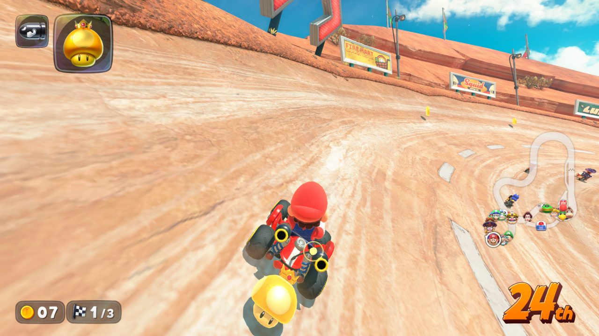

# Original main integration — 2026-11-05

## Scope and provenance

Original `seedds/nxnative` main is pinned to `865cc35fad7034d17c2190f8ce349f61f5bcaba1`, checked again during integration. The previous integrated pin was `4a2a81a64f029d0a75ade9523c8ffc6c89465375`: 193 new commits. A real merge retains their original authors and history. This replaces draft review proposals #7, #14, #20 and #26; a proposal is not an integration.

The catalog grows from 130 to 143 applications. Fifteen profile folders were added: thirteen standalone applications plus Super Mario 64 and Sunshine inside the All-Stars parent application. Eight existing profiles changed. Both language galleries, artwork mappings, the live catalog and the website use the same generated inventory.

## Engine and fork reconciliation

Imported renderer/service/SDK fixes, Ampere task/mesh translation, sparse/memory work, dav1d AV1 decoding, NUP containers, multi-program packaging, compact library images/SQLite compilation cache, portrait layouts and the iOS live game menu. New games include Mario Kart World, Skyward Sword HD, Brothership, Princess Peach Showtime, Kirby Star Allies, DQ Builders 2, Dave the Diver, All-Stars, Pokopia, Star Fox, Yoshi, Mario Tennis Fever and Hyrule Warriors.

Preserved Easy's library, dotted engine versions, updater, signing identities, Keychain/session behavior, bounded device discovery, progress/logs, full/light iOS packaging and the four editable touch profiles. The custom immutable cloud history, explicit conflicts, lease and transactional recovery remain in place; original newer-wins cloud arbitration is excluded. Multi-program compatibility identities now include child executable/content digests and use the shared parent save container. No real progress is used for tests.

Original automatic old-cache pruning and work-folder compression remain explicit opt-in in the CLI. Easy retains preview-based cleanup. iOS full-bundle RomFS/DLC priority does not delete older external content. Existing apps, original packages, keys and saves remain intact.

NUP identification is keyless and Mac-only in Easy: bounded metadata reads, integrity checks, exact title/version/update identification and pre-build source revalidation. Parent/child catalog relationships are checked rather than silently hiding unknown profiles.

## Fork issue #19

The vendored signing client normalizes only the legacy macOS 10.12.6 anisette provider identity to its existing modern AuthKit identity, consistently for login and 2FA. Modern Mac and Android provider identities remain unchanged. Two provider/header tests pass. This implements the reporter's successful workaround; synthetic tests do not establish a new real-account login, SMS delivery or physical installation. No credentials are logged or changed.

The CI pass also exposed a retained-log ordering race: console output could reach the UI before its file was flushed. The worker now persists each line before publishing it. Its streaming test uses an acknowledgement rather than a timing sleep, retaining exit status, UTF-8 and private file-mode checks.

## Mario Kart World

The owner's extracted base matches build `9e244438c3d8ef1c703a6a85ef99c4f0`, internal version 0. All 11,561 shaders translate, the self-contained Mac app builds and its signature verifies. An isolated seven-minute run reaches an interactive race (first lap, 24 racers) with a private scratch save; the prior Easy engine lacked this newly merged profile. Compilation alone was not the compatibility check. A first-lap capture confirms gameplay; remaining CPU texture fallback and VP9 queue warnings are recorded, and full races/long sessions remain unchecked; no iPhone/iPad or online-play claim is made. The adjacent emulator/Windows binaries were not executed.

## Validation

Completed before the integration commit: production unsigned iOS project; host unit tests; full GPU tests; 23 native cloud recovery/conflict cases; provider identity tests; NUP metadata/corruption/stale-source tests; catalog and documentation checks. The tool suite contains 101 isolated modules and the fork suite 35; initial test expectations affected by optional cleanup/timezone/import changes were corrected and rerun. Static analysis reduced existing baseline entries from 387 to 384 with no additions.

Additional completed checks: 193 isolated Python modules (101 tools, 45 graphics, 12 iOS, 35 fork), with recorded affected retries; 28 native helper cases, two provider-identity cases and two live redacted protocol cases; website build/check; Dread Mac/iOS shader rebuilds. Full C static analysis has zero findings above the 230-entry upstream baseline after fixing a nullable-resource check in one imported GPU test. Dread baseline/candidate boot routes both render at about 59.6 fps with no RED kinds; shader differences are expected from the imported chain.

The full baseline/candidate check finished with **CHANGED**, exit0: expected translated output changes and no new failing shader, pipeline-interface error, boot failure or RED kind. Dread:1010/1010 shaders on both revisions; Zelda:9698/9698 on both. Both120-second boot routes pass screenshot tolerances. Zelda prebuilds17,742 pipeline bases on each revision, zero failures. These are boot/title routes with fresh scratch saves, not completed-game playthroughs. Measurements were marked busy, so the frame-rate figures are descriptive and not a controlled performance claim.

See [the complete regression report](2026-11-05-regressions.md). Final runtime source is unchanged from validated candidate93163ff5, apart from the separately tested GPU-test checks; the frontend log-order fix has its own test and a successful ten-check GitHub matrix. The catalog, documentation, website and both language input limits pass their final checks.

Publication is gated separately on the final source revision: all ten applicable GitHub checks, portable signature/source index, current/installed/1.20 production updater staging, uploaded asset digests and public tag/main/latest agreement. The version is1.32.0 build58, engine1.0.2. No release is considered public merely because this pre-publication review file exists. Existing games need preparation again to receive the engine; signature-only renewal does not rebuild.
